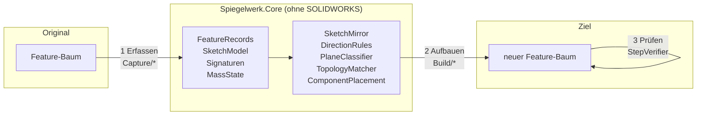
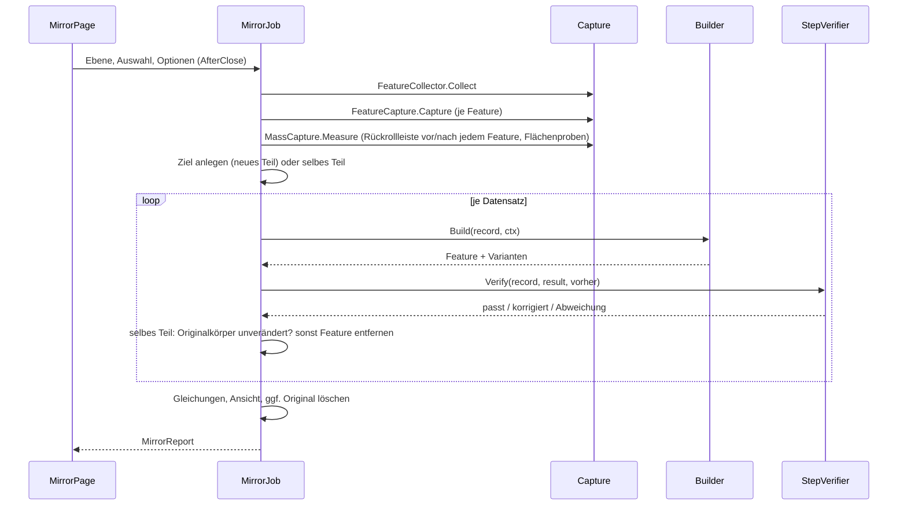

# Architektur

## Grundidee

SOLIDWORKS kennt nur abhängiges Spiegeln: Ein Spiegel-Feature verweist auf seine Quelle und rechnet bei jeder Änderung nach. Spiegelwerk verwendet keine Spiegel-API (`InsertMirrorFeature`, `MirrorPart`, abgeleitete Teile), sondern liest jedes Feature des Originals als **Daten** und erzeugt daraus mit den gewöhnlichen Methoden von `FeatureManager` und `SketchManager` ein neues Feature an gespiegelter Lage.

Der Lauf hat drei streng getrennte Phasen:



1. **Erfassen** (`Capture/`): Feature-Auswahl, Skizzen und Feature-Definitionen werden in neutrale Datensätze übersetzt. Bezüge auf Geometrie (Kanten einer Verrundung, Fläche einer „bis Fläche“-Endbedingung, Drehachse) werden als **geometrischer Fingerabdruck** gespeichert, nicht als SOLIDWORKS-Objekt. Für die spätere Prüfung wird gemessen, was jedes Feature am Volumen geändert hat.
2. **Aufbauen** (`Build/`): Jeder Datensatz wird gespiegelt im Ziel erzeugt. Nach dieser Phase wird das Original nicht mehr angefasst – im Ziel kann es daher keinen Verweis darauf geben.
3. **Prüfen** (`Build/StepVerifier`): Nach jedem Feature wird die Volumen- und Schwerpunktänderung mit der gespiegelten Änderung des Originals verglichen. Weicht sie ab, werden die vom Builder angebotenen Varianten (Richtung umkehren, Wandseite wechseln …) durchprobiert und die passende behalten.

Alles, was sich ohne SOLIDWORKS rechnen lässt, liegt in `Spiegelwerk.Core` (netstandard2.0) und ist mit Unit-Tests abgesichert. Das Add-In (`Spiegelwerk`, .NET Framework 4.8) übersetzt nur zwischen SOLIDWORKS und diesen Typen.

## Klassen

### Spiegelwerk.Core

| Namespace | Klasse | Aufgabe |
| --- | --- | --- |
| `Geometry` | `Vec3`, `Plane3`, `Line3`, `Frame3`, `Affine`, `Reflection`, `Tol` | Punkte, Ebenen, Koordinatensysteme; die Spiegelung `R(p) = p − 2((p − p₀)·n)n`; Toleranzen |
| `Sketch` | `SketchModel`, `SkPoint`, `SkSegment`, `SkRelation`, `SkDimension`, `SkRef` | Neutrale Skizze: Punkte mit IDs, Segmente verweisen auf Punkte, Beziehungen/Bemaßungen auf Punkte und Segmente oder auf externe Bezüge |
| | `SketchMirror`, `AxisMap` | Spiegelt eine Skizze in ein gegebenes Ziel-Koordinatensystem, rechnet Beziehungen und Bemaßungen um |
| `Planning` | `DirectionRules` | σ und die Regeln für Richtungsflags und Bogensinn |
| | `PlaneClassifier` | Welche Ebene trägt die gespiegelte Skizze: vorhandene, versetzte Standardebene oder Drei-Punkte-Ebene |
| | `ComponentPlacement` | Platzierung des gespiegelten Teils in der Baugruppe |
| | `PatternInstances` | Lage der Musterinstanzen spiegeln (R ∘ T ∘ R) und als Mengen vergleichen |
| | `HoleAxis` | Wo eine Bohrungsachse den Körper verlässt (fernseitige Fläche der erweiterten Bohrung) |
| `Matching` | `EdgeSignature`, `FaceSignature`, `TopologyMatcher` | Fingerabdrücke und deren Zuordnung im neu aufgebauten Teil |
| `Verification` | `MassState`, `MassComparison` | Volumen und erstes Moment, gespiegelt und verglichen |
| `Records` | `FeatureRecord` und Ableitungen (`SweepLoftRecords.cs`, `PatternRecords.cs`, `HoleRecords.cs` mit der gemeinsamen Basis `PositionedHoleRecord` und der Typzuordnung `HoleTypes`, `AdvancedHoleRecords.cs`, `ShellDraftRecords.cs`, `VariableFilletRecords.cs` mit `EdgeLocation`, `FaceFilletRecords.cs`), `GeometryRef`, `MirrorOptions`, `MirrorReport` | Erfasste Features samt Flächenproben, Optionen, Bericht |

### Spiegelwerk (Add-In)

| Ordner | Klasse | Aufgabe |
| --- | --- | --- |
| `Addin/` | `SpiegelwerkAddin` | `ISwAddin`, COM-Registrierung, Befehlsgruppe und Registerkarte |
| | `IconFactory` | Zeichnet das Befehlssymbol zur Laufzeit in allen Größen |
| `UI/` | `MirrorPage` | PropertyManager-Seite (`IPropertyManagerPage2Handler9`) |
| | `ReportForm` | Ergebnisliste |
| `Sw/` | `SwMath` | `MathTransform` ↔ `Frame3`/`Affine`, Skizzen- und Ebenenkoordinaten |
| | `SwDoc`, `SwSelect` | Feature-Baum, Standardebenen, Körper, Massen; Auswahl mit Markierung |
| | `SwPattern` | Lage der Instanzen eines Musters lesen (`GetTransform`) |
| | `SwHole` | Maße und Optionen einer Bohrung lesen, vergleichen, setzen; Positionsskizze finden |
| | `SwAdvancedHole` | Elemente einer erweiterten Bohrung lesen, anlegen, vergleichen, setzen; Positionsskizze finden |
| | `SwLate` | Spät gebundener Zugriff auf API-Teile, die erst neuere Versionen haben |
| | `SwPreferences`, `SketchInputScope`, `UpdateFreeze` | Benutzereinstellungen und Anzeige während des Laufs abschalten und wiederherstellen |
| `Capture/` | `FeatureCollector` | Welche Features, in Erstellungsreihenfolge |
| | `SketchCapture` | `ISketch` → `SketchModel` |
| | `FeatureCapture` (+ `.SweepLoft`, `.Patterns`, `.Holes`, `.AdvancedHole`, `.ShellDraft`, `.VariableFillet`, `.FaceFillet`) | Feature-Definitionen → `FeatureRecord` (mit `AccessSelections`) |
| | `TopologyCapture` | Kante/Fläche/Eckpunkt → Fingerabdruck |
| | `MassCapture` | Volumenänderung und Flächenproben jedes Features über die Rückrollleiste |
| `Build/` | `MirrorJob` | Der ganze Lauf; neues Teil anlegen, Gleichungen kopieren, Original löschen |
| | `BuildContext`, `SketchMap` | Zustand des Laufs; Zuordnung alter → neuer Skizzenelemente |
| | `PlaneResolver` | Liefert für eine Ebene ein Ebenen-Feature im Ziel, für eine Gerade eine Achse |
| | `TopologyFinder` | Findet Kanten, Flächen, Eckpunkte, Achsen und Skizzen im Ziel |
| | `SketchBuilder` | Schreibt eine gespiegelte Skizze – neu oder in eine vorhandene (Positionsskizze einer Bohrung) |
| | `Builders/*` | Ein Builder je Feature-Typ: Skizze, Ebene, Achse, Extrusion, Rotation, Austragung, Ausformung, Verrundung, variable Verrundung, Flächen- und vollständige Verrundung, Fase, Wandung, Formschräge, Bohrung, erweiterte Bohrung, Muster |
| | `StepVerifier` | Messen (Volumen, Moment, Flächenproben), Varianten probieren |
| `AssemblyContext/` | `AssemblyMirror` | Komponente spiegeln, speichern, platzieren |

## Ablauf im Detail



**Reihenfolge:** `SwDoc.FeaturesInCreationOrder` sortiert nach Abhängigkeiten (`CreationOrder`): absorbierte Skizzen vor dem Feature, das sie verbraucht, und jedes Feature nach seinen Eltern – wo auch immer diese im Baum stehen. Der Baum allein reicht nicht: Eine Ausformung zeigt ihre Profilskizzen unter sich, eine später gezeichnete Führungskurve mit Beziehungen zu den Profilen steht aber oben im Baum, vor der Ausformung. Ein Feature findet beim Neuaufbau so immer schon die Skizzen, Ebenen und Kanten vor, die es braucht; ein unveränderter Baum bleibt in seiner Reihenfolge (Tests in `CreationOrderTests`).

**Auswahl:** Ohne Auswahl wird das ganze Teil gespiegelt. Gewählte Features nehmen nur die Skizzen mit, aus denen sie gebaut sind – eine gespiegelte Tasche soll den vorhandenen Körper schneiden, nicht den Körper, aus dem sie geschnitten wurde, noch einmal aufbauen. Gewählte Körper nehmen alle Features mit, die zu ihnen beigetragen haben (`IBody2.GetFeatures`). Ein gewähltes Muster nimmt seine Saat mit – ohne sie hätte es nichts zu wiederholen: die Saat-Features, bei Flächenmustern die Features, zu denen die Flächen gehören, bei Körpermustern die Features, aus denen die Körper entstanden sind. Wie bei gewählten Körpern entsteht im selben Teil dann ein eigener Körper, sonst verschmölze die gespiegelte Saat mit dem Original. Ein Muster ohne auffindbare Saat scheitert, bevor eine Hilfsachse oder -ebene angelegt wird.

## Die Mathematik

### Spiegelung und σ

Die Spiegelung an der Ebene (p₀, n) ist `R(p) = p − 2((p − p₀)·n)n`. Sie ist längen- und winkeltreu, aber **orientierungsumkehrend**: `R(a) × R(b) = −R(a × b)`. Daraus folgt alles Weitere.

Eine Skizze auf der Ebene S mit Normale z landet auf R(S). Auf welcher Ebene im Ziel skizziert wird und wie SOLIDWORKS deren Skizzenachsen legt, entscheidet nicht Spiegelwerk; die Ziel-Normale z′ ist entweder R(z) oder −R(z). Das Vorzeichen

    σ = sign(z′ · R(z))

steuert alle Richtungsfragen (`DirectionRules`):

| | σ = +1 | σ = −1 |
| --- | --- | --- |
| 2D-Abbildung in der Skizze | Spiegelung | Drehung |
| Bogensinn | umgekehrt | gleich |
| „Richtung umkehren“ (Extrusion) | gleich | umgekehrt |

Beispiel: Skizze auf der Ebene *vorne*, gespiegelt an *rechts*: Ziel ist wieder *vorne*, σ = +1, x-Koordinaten wechseln das Vorzeichen, Bögen laufen andersherum, die Extrusion geht in dieselbe Richtung. Skizze auf *rechts*, gespiegelt an *rechts*: dieselbe Ebene, aber R(z) = −z, also σ = −1 – die 2D-Koordinaten bleiben gleich, die Extrusion muss umgedreht werden.

Ob SOLIDWORKS einen Aufsatz entlang und einen Schnitt entgegen der Normale extrudiert, spielt dabei keine Rolle: Die Konvention gilt für Original und Kopie gleichermaßen und kürzt sich heraus (Test `Extrude_direction_follows_the_mirror_for_every_plane_combination`).

### Prüfung über Volumen und erstes Moment

Volumen V und erstes Moment M = Σ Vᵢ·cᵢ aller Volumenkörper sind additiv; die Änderung durch ein Feature ist „nachher − vorher“. Für die gespiegelte Änderung braucht man die Körper nicht:

    V′ = V,    M′ = M − 2((M − V·p₀)·n)n

`MassComparison` vergleicht Volumen und Moment getrennt – relativ zur Größe der Änderung (1e-4 beim Volumen, 10 µm beim Schwerpunkt), aber nie feiner als das Rauschen, das aus dem ganzen Teil folgt. Getrennt deshalb, weil eine Änderung mit dem Nettovolumen null (eine Verrundung, die innen ansetzt und außen wegnimmt) trotzdem ein klares Moment hat. Damit wird aus „in welche Richtung legt SOLIDWORKS das standardmäßig?“ eine Messung; eine Variante, die das Feature in einen Fehlerzustand bringt, gewinnt dabei nie.

### Prüfung über Flächenproben

Manche Varianten haben dasselbe Volumen und denselben Schwerpunkt: eine Austragung, die mit symmetrischem Profil in die falsche Richtung verdreht ist, eine Ausformung mit gleich großen, aber anders verbundenen Profilen. Deshalb nimmt `MassCapture` im selben zurückgerollten Zustand bis zu acht Punkte auf den Flächen, die das Feature erzeugt hat (`IFeature.GetFaces`). Gespiegelt muss jeder dieser Punkte auf einer Fläche der Kopie liegen (Abstand ≤ 10 µm, gemessen vom Kern). Gesucht wird zuerst auf den Flächen des neuen Features, dann auf allen Flächen der infrage kommenden Körper – eine koplanare Fläche, die mit einer älteren verschmolzen ist, gehört zu jener. `StepVerifier` wertet zuerst die Zahl der verfehlten Prüfungen (Fehlerzustand, Masse, Form), dann die verfehlten Proben, dann die Massenabweichung.

### Muster: Lage der Instanzen

Ein Muster meldet für jede Instanz die Platzierung Tᵢ: Saat → Instanz (`GetTransform`). Im gespiegelten Teil liegt die Instanz bei R(Tᵢ(x)), die Saat bei R(x); das neue Muster muss also

    Tᵢ′ = R ∘ Tᵢ ∘ R

melden. Eine Verschiebung um d wird zur Verschiebung um R(d), eine Drehung um φ um die Achse a zur Drehung um −φ um R(a) – der Drehsinn kehrt sich um. `PatternBuilder` liest die Platzierungen des neuen Musters, vergleicht sie als **Menge** mit den gespiegelten (`PatternInstances.Unmatched`; die Nummerierung bei zwei Richtungen ist nicht dokumentiert, und bei gleichem Abstand über 360° sind beide Drehsinne richtig) und probiert die Richtungsflags durch, bis die Mengen gleich sind. Damit hängt nichts an der inneren Richtung einer Kante oder Achse im neuen Teil (Tests in `PatternTests`).

### Baugruppe

Original-Komponente: Teilgeometrie x, Platzierung T. Gewünscht ist R_asm(T(x)). Das neue Teil wird als R_part(x) gebaut. Die Platzierung T′ muss T′(R_part(x)) = R_asm(T(x)) erfüllen:

    T′ = R_asm ∘ T ∘ R_part

Zwei Spiegelungen und eine starre Bewegung ergeben Determinante +1 – eine gültige Komponententransformation. Weil R_part frei wählbar ist, spiegelt Spiegelwerk das Teil an **seiner eigenen** Standardebene durch den Ursprung, deren Normale der Baugruppen-Spiegelebene am nächsten liegt. Das neue Teil sieht dann aus wie ein konstruiertes Gegenstück (Skizzen auf vorne/oben/rechts) und nicht wie eine irgendwo im Raum verschobene Kopie (`ComponentPlacement`, Test `Component_placement_puts_the_mirrored_part_where_the_mirror_image_is`).

## Bohrungen

Eine Bohrung des Bohrungsassistenten besteht aus dem Feature und zwei eigenen Skizzen: der Profilskizze und der Positionsskizze, deren Punkte die Bohrungen sind (`IWizardHoleFeatureData2.GetSketchPoints` zeigt, welche die Positionsskizze ist). Beide entstehen in SOLIDWORKS mit der Bohrung und werden deshalb nicht einzeln aufgebaut (`PartOfFeatureRecord`); die Positionsskizze wird mit der Bohrung erfasst. Das gilt nur, solange die Bohrung selbst neu aufgebaut wird: Ist sie nicht Teil des Laufs, nicht unterstützt oder übersprungen, wird die Positionsskizze wieder als gewöhnliche Skizze erfasst und die Profilskizze entfällt mit Hinweis; scheitert die Bohrung beim Aufbau, nimmt der Bericht das „entsteht mit ihr“ der beiden Skizzen zurück.

`HoleBuilder`:

1. **Eine Bohrung anlegen** wie in der API-Hilfe beschrieben: `CreateDefinition(swFmHoleWzd)`, `InitializeHole` mit Typ, Norm, Schraubenart, Größe und Endbedingung, Maße und Optionen setzen, Platzierungsfläche am ersten gespiegelten Bohrpunkt wählen, `CreateFeature`. Ersatzweg: `HoleWizard5`. Den allgemeinen Typ, den beide Wege verlangen, liefert die API nicht; `HoleTypes.GenericOf` leitet ihn aus dem genauen Typ ab (Tests in `HoleTests`).
2. **Positionsskizze übertragen:** `SketchBuilder.BuildInto` öffnet die Positionsskizze der neuen Bohrung, schreibt die gespiegelte Skizze hinein – alle Bohrpunkte mit Beziehungen und Bemaßungen, Bezüge zu Kanten wie bei jeder Skizze – und entfernt den Punkt, den Schritt 1 gesetzt hat.
3. **Maße abgleichen:** Nur Werte, die von den Normmaßen der neuen Bohrung abweichen, werden geschrieben (`SwHole`); eine Normbohrung bleibt so eine Normbohrung. Dazu Endbezug und Feature-Bereich.
4. **Zählen:** Die Kopie muss so viele Bohrungen haben wie das Original.

Die Bohrrichtung bezieht sich auf die Normale der Positionsskizze. Auf einer Fläche ist das die Außennormale, und die bleibt bei einer Spiegelung außen (σ = +1) – das Flag „Richtung umkehren“ bleibt. Liegt die Bohrung auf einer Ebene (oder steht eine Ebene für eine nicht gefundene Fläche), kann die Skizze andersherum liegen; dann folgt das Flag σ wie bei Extrusionen. Ersatzpunkte für fehlende Skizzenbezüge sind in der Positionsskizze Endpunkte fixierter Konstruktionslinien, denn jeder eigene Skizzenpunkt wäre eine zusätzliche Bohrung. Maße werden nicht gespiegelt, auch nicht die Gewinderichtung: Ein Gegenstück bekommt dieselben Bohrungen mit denselben Rechtsgewinden. Eine geometrische Spiegelung würde Linksgewinde ergeben; die kosmetische Gewindedarstellung trägt aber gar keine Drehrichtung.

### Erweiterte Bohrung

Eine erweiterte Bohrung ist ein Stapel von Elementen (Senkung zylindrisch oder kegelig, Bohrung, Gewinde, Kegelgewinde) von der nahseitigen Fläche ins Material, wahlweise ein zweiter Stapel von einer fernseitigen Fläche aus. Ihre Positionsskizze wird wie beim Bohrungsassistenten behandelt – beide Bohrungsarten teilen die Basis `PositionedHoleRecord`, und alles, was an Teil-Skizzen hängt (`PartOfFeatureRecord`, Wiedererfassen, Zurücknehmen, Entfernen samt Skizzen), gilt für beide. Die Positionsskizze ist die 2D-Unterskizze mit den meisten Skizzenpunkten; einen Getter dafür hat `IAdvancedHoleFeatureData` nicht.

Die Feature-Daten nennen weder die nah- noch die fernseitige Fläche. Erfasst werden sie geometrisch im Zustand vor der Bohrung (Rückrollleiste vor das Feature): nahseitig die ebene Fläche unter einem Bohrpunkt, parallel zur Positionsskizze; fernseitig die ebene Fläche desselben Körpers, durch die die Bohrungsachse den Körper zuerst verlässt (`HoleAxis.FirstExit`, Tests in `AdvancedHoleTests`). Das trifft jede gewöhnliche Platte und jeden Flansch; wer eine andere Fläche gewählt hat, sieht es am Bericht, der die Annahme nennt, und an der Prüfung.

`AdvancedHoleBuilder`:

1. **Eine Bohrung anlegen** wie im Beispiel der API-Hilfe: nahseitige Fläche am ersten gespiegelten Bohrpunkt wählen, fernseitige dazu, Elemente mit `CreateAdvancedHoleElementData` anlegen und füllen (`SwAdvancedHole`: erst Norm, Schraubenart, Größe, dann die Schalter – eigener Durchmesser, Standardtiefe, Passung, Bohrspitze, Gewindeklasse –, dann Endbedingung samt Bezug, dann die Werte), `IFeatureManager.AdvancedHole`. Welche Auswahlmarkierungen der Aufruf erwartet und ob er ein Objekt-Array oder `DispatchWrapper` will, ist nicht dokumentiert: Die Varianten werden der Reihe nach versucht; liegt die Positionsskizze der neuen Bohrung auf der fernseitigen Fläche, waren die Seiten vertauscht: Die Bohrung wird wieder entfernt, und als Nächstes kommt dieselbe Variante mit getauschten Flächen (Markierungen und Reihenfolge). Beide Flächen müssen als Flächen gefunden werden – eine Ersatzebene, wie sie Endbezüge bekommen dürfen, legt der Builder hier gar nicht erst an.
2. **Positionsskizze übertragen** mit `SketchBuilder.BuildInto`, wie beim Bohrungsassistenten.
3. **Elemente abgleichen:** jedes Element mit dem Original vergleichen; was abweicht, in einem `FeatureEdit` korrigieren – nur die Seite, die abweicht, bei gleicher Anzahl und Typfolge in den vorhandenen Elementen, sonst mit neuen (`SetNearSideElements`/`SetFarSideElements`), in der Array-Form, die beim Anlegen angenommen wurde.
4. **Zählen.**

Eine Richtung gibt es nicht zu spiegeln: Die Elemente laufen von ihrer Fläche ins Material, und die Spiegelung lässt Außennormalen außen. Einen Feature-Bereich hat die API für die erweiterte Bohrung nicht; im selben Teil entfernt die Originalprüfung von `MirrorJob` eine Bohrung, die das Original erreichen würde. „Tiefe bis zur Spitze“ (`AdvancedHole2`, erst in neueren Versionen) ist aus den Feature-Daten nicht lesbar und bleibt bei der Voreinstellung.

## Variable Verrundung

Radien ändern sich bei einer Spiegelung nicht, wohl aber die Richtung, in der eine Kante läuft. Eckradien hängen an Eckpunkten und werden über deren gespiegelte Lage zugeordnet. Kontrollpunkte hängen an einer Kante und einer Lage entlang dieser Kante, gezählt von ihrem Anfang. Läuft die neu aufgebaute Kante andersherum als die gespiegelte, wird die Lage vom anderen Ende gezählt (`EdgeLocation.Map`, Tests in `VariableFilletTests`); bei geschlossenen Kanten legt der Kern die Naht frei, dort wird nichts geraten.

`FeatureFillet3` legt die Verrundung an; in welcher Reihenfolge es Radien und Kontrollpunkte erwartet, ist nicht dokumentiert. Deshalb werden alle Werte danach auf den Feature-Daten gesetzt, unter `AccessSelections` – dann ist das Modell vor die Verrundung zurückgerollt, und ihre Kanten und Eckpunkte existieren: Eckradius je Eckpunkt nach Lage, Kontrollpunkte je Kante nach Anzahl (SOLIDWORKS beginnt mit drei je Kante bei 25, 50, 75 %), Übergang, Überlauf, Fortsetzung wie gelesen.

## Flächen- und vollständige Verrundung

Beide beziehen sich nur auf Flächen: zwei Flächengruppen (Flächenverrundung) oder zwei Seitengruppen und eine Mittelgruppe (vollständige Verrundung). Die Flächen werden über ihre gespiegelten Fingerabdrücke gefunden und mit den dokumentierten Markierungen gewählt (Gruppe 1: 2, Gruppe 2: 4, Mitte: 512). Fehlt eine Fläche, entsteht keine Verrundung – zwischen anderen Flächen wäre es eine andere. Die Flags „Normale umkehren“ beziehen sich auf die Außennormalen, die eine Spiegelung außen lässt; sie gehen unverändert als Optionen mit, die Gegenrichtung beider Gruppen zusammen und jeder einzeln bleibt als Variante für die Prüfung. Haltelinien werden danach auf den Feature-Daten gesetzt; mit Haltelinien ist der gespeicherte Radius nur ein Platzhalter für das Anlegen.

## Wandung und Formschräge

Eine **Wandung** ist ganz auf den Körper bezogen: Wandstärke, innen oder außen, offene Flächen, Flächen mit eigener Stärke. Eine Spiegelung ändert daran nichts außer den Flächen selbst, die über ihre gespiegelten Fingerabdrücke wiedergefunden werden. Die offenen Flächen werden für `InsertFeatureShell` gewählt; Flächen mit eigener Stärke und die Richtung werden danach auf den Feature-Daten gesetzt. Eine geschlossene Wandung (hohler Körper) hat keine offenen Flächen, die den Körper verraten; erfasst wird deshalb eine Fläche des ausgehöhlten Körpers, die nicht von der Wandung stammt (mit der Rückrollleiste direkt hinter der Wandung). Sie liegt dort, wo vor der Wandung eine Fläche des Körpers lag – bei einer Wandung nach innen weiterhin außen, nach außen als Wand des Hohlraums, dann mit umgekehrter Normale. Im Ziel wird der Körper gewählt, auf dessen Fläche der gespiegelte Punkt liegt (berühren sich zwei Körper dort, entscheidet der ganze Fingerabdruck) – im selben Teil mit eigenem Körper (ganzes Teil oder gewählte Körper) nur unter den gespiegelten Körpern. Ist das nicht eindeutig, entsteht keine Wandung. Sind im selben Teil nur Features gewählt, wirkt die Wandung wie jedes andere Feature auf den vorhandenen Körper, auf dem der gespiegelte Punkt liegt.

Eine **Formschräge** neigt Flächen um einen Winkel gegen eine Zugrichtung: die Normale der neutralen Ebene oder die Richtung des Zugbezugs (Ebene, ebene Fläche, Kante). Werden Flächen und Zugrichtung zusammen gespiegelt, bleibt der Winkel, wie er ist. Das Flag „Richtung umkehren“ bezieht sich aber auf den Bezug, und der Bezug der Kopie kann andersherum zeigen – eine zusammenfallende Ebene mit entgegengesetzter Normale, eine Kante, die andersherum läuft. Deshalb folgt das Flag σ der Bezugsrichtung (`DirectionRules.Sigma` mit der Bezugsrichtung statt der Skizzennormale, `BuilderSupport.FlagForReference`, Tests in `DraftDirectionTests`). Eine Zugrichtung entlang einer Kante wird als Achse des Laufs, gerade Kante oder Hilfsachse aufgelöst, nicht als Skizzenlinie. Welche Seite einer Trennlinie geneigt wird, hängt an der inneren Orientierung der Kante; übernommen, die Gegenseite als Variante.

## Ebenen und Achsen im Ziel

`PlaneResolver` liefert für jede gespiegelte Skizzenebene ein Ebenen-Feature, das **nicht** vom Original abhängt:

1. Fällt sie mit einer vorhandenen Ebene zusammen (Standardebene oder eine schon angelegte), wird diese verwendet – egal mit welcher Normalenrichtung; σ fängt das ab.
2. Ist sie parallel zu einer Standardebene, entsteht eine Versatzebene davon. Die Seite des Versatzes wird nachgemessen und bei Bedarf umgedreht.
3. Sonst entsteht eine Ebene durch drei fixierte Punkte einer Hilfs-3D-Skizze („Spiegelwerk-Anker“).

Die Standardebenen werden über ihre Geometrie gefunden, nicht über den Namen („Ebene vorne“, „Front Plane“ …).

Achsen (Drehachse, Musterrichtung, Extrusionsrichtung) sucht `TopologyFinder.FindLineObject` in dieser Reihenfolge: eine Achse des Laufs, eine neu aufgebaute Skizzenlinie, eine gerade Kante – im selben Teil nur auf den gespiegelten Körpern. Liegt nichts auf der gespiegelten Geraden, legt `PlaneResolver` eine Hilfsachse an: Bezugsachse auf einer fixierten Linie einer Hilfs-3D-Skizze. Referenzachsen des Originals werden auf dieselbe Weise unter ihrem Namen neu angelegt.

## Kanten und Flächen wiederfinden

Kanten und Flächen haben keine dokumentübergreifende Identität. Spiegelwerk speichert beim Erfassen einen Fingerabdruck (`EdgeSignature`: Kurventyp, Endpunkte, Punkt in Parametermitte, Länge, bei Kreisen Mittelpunkt/Radius/Achse; `FaceSignature`: Flächentyp, Inhalt, ein Punkt auf der Fläche, bei Ebenen die Außennormale). Gelesen wird während `AccessSelections` – dann ist das Modell auf den Stand des Features zurückgerollt, und eine Kante, die später von einer Verrundung geteilt wird, ist noch ganz.

Beim Aufbau wird der gespiegelte Fingerabdruck im Ziel gesucht (`TopologyMatcher`). Das Ziel befindet sich in diesem Moment genau im gespiegelten Zustand des Originals, deshalb passt die Suche exakt. Zwei Halbkreise mit gleichen Endpunkten unterscheidet der Mittelpunkt; gibt es dieselbe Kante zweimal (selbes Teil, Kante auf der Spiegelebene), gewinnt der Körper, den der Lauf selbst erzeugt hat. Geschlossene Kanten haben eine Naht, die der Kern frei wählt: Vollkreise werden deshalb über Mittelpunkt, Radius und Achse verglichen, geschlossene Ellipsen und Splines über den Abstand der gespiegelten Punkte zur Kandidatenkurve, den der Kern misst. Bezüge, die vor dem Erzeugen eines Features gefunden werden, gehen als „sichere“ Entitäten (`GetSafeEntity`) über den Neuaufbau.

Findet sich eine ebene Bezugsfläche nicht, wird eine Ebene durch die gespiegelte Fläche verwendet; „bis Fläche“ auf eine zur Skizze parallele Ebene kann auch in die gleichwertige feste Tiefe umgewandelt werden.

## Selbes Teil

Wird das ganze Teil oder ein Körper im selben Teil gespiegelt, entsteht ein eigener Körper. Aufsätze werden zunächst ohne Verschmelzen erzeugt; Verschmelzen und Feature-Bereich setzt dann ein einziges `ModifyDefinition`, und zwar mit den Körpern aus dem zurückgerollten Zustand vor dem Feature – dort gibt es den gespiegelten Körper noch für sich, nie schon mit dem Original verschmolzen. Schnitte wirken nur auf die vom Lauf erzeugten Körper; gibt es noch keinen, wird der Schnitt gar nicht angelegt. Lässt sich der Feature-Bereich nicht setzen, wird das Feature wieder entfernt. So schneidet oder verschmilzt ein gespiegeltes Feature nie mit dem Original, auch wenn sich beide berühren – ein Fall, den der Volumenvergleich nicht sehen könnte. Austragungen und Ausformungen folgen demselben Muster. Muster haben erst in neueren API-Versionen einen Feature-Bereich (in der Interop 2024 vorhanden, in 2019 nicht); wo es ihn gibt, wird er spät gebunden gesetzt. In jedem Fall misst `MirrorJob` nach jedem Feature Volumen und Moment der Originalkörper: Hat sich daran etwas geändert, wird das Feature wieder entfernt und als fehlgeschlagen gemeldet. Ein abgelehntes Feature wird geprüft, bevor seine Bezüge aufgelöst werden – so bleiben keine Hilfsebenen oder -achsen zurück. Feature-Namen bekommen den Namenszusatz.

Ebenen des Originals verwendet der `PlaneResolver` im selben Teil nicht: Er kennt nur die Standardebenen und die Ebenen, die der Lauf selbst anlegt.

„Original löschen“ wird nur ausgeführt, wenn jedes Feature ein fehlerfreies Gegenstück hat (`MirrorReport.AllMirrored` – übersprungene Achsen, 3D-Skizzen oder Koordinatensysteme blockieren) und kein anderes Feature vom Original abhängt.

## Einen Feature-Typ ergänzen

Ein neuer Typ braucht drei Teile:

1. **Datensatz** in `Spiegelwerk.Core/Records/FeatureRecords.cs` – nur Zahlen, Flags und `GeometryRef`/Signaturen, keine SOLIDWORKS-Objekte.
2. **Erfassen** in `FeatureCapture.Capture`: Definition lesen, Bezüge zwischen `AccessSelections` und `ReleaseSelectionAccess` in Fingerabdrücke übersetzen.
3. **Builder** in `Build/Builders/` und Eintrag in `MirrorJob.Builders`.

Die Builder für Austragung, Ausformung und Muster zeigen die üblichen Bausteine: Bezüge mit `BuilderSupport.Find` gespiegelt im Ziel auflösen, `PlanSeparateBody` für das selbe Teil, Feature mit den dokumentierten Markierungen anlegen, alles Weitere in einem `FeatureEdit`, Unsicheres als `Alternative` anbieten. Skizze einer Wandung:

```csharp
internal sealed class ShellBuilder : IFeatureBuilder
{
    public bool Handles(FeatureRecord r) => r is ShellRecord;

    public BuildResult Build(FeatureRecord record, BuildContext ctx)
    {
        var r = (ShellRecord)record;
        var notes = new List<string>();
        // Entfernte Flächen: gespiegelte Fingerabdrücke im Ziel suchen.
        var faces = r.RemovedFaces.Select(f => ctx.Topology.FindFace(f.Mirror(ctx.Mirror), notes)).ToList();
        if (faces.Any(f => f == null)) return BuilderSupport.Fail("Entfernte Fläche im Ziel nicht gefunden.", notes);
        // ... Flächen wählen (Markierung laut Hilfe prüfen), FeatureManager.InsertFeatureShell(...),
        //     „nach außen“ ist eine Seite – als Alternative anbieten, die Prüfung entscheidet.
        ...
    }
}
```

Eine Spiegelung kehrt jede Drehrichtung um: Kreismuster und Verdrehungen von Austragungen laufen in der Kopie gegensinnig (das erledigen `PatternBuilder` und `SweepBuilder`). Bei beiden Bohrungsarten läuft das Bohrbild (Positionsskizze) als gewöhnliche Skizze durch `SketchBuilder` – nur in die vorhandene Skizze der Bohrung hinein.
