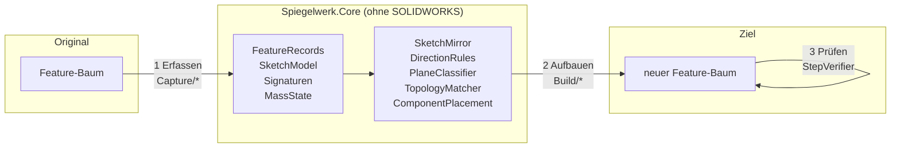
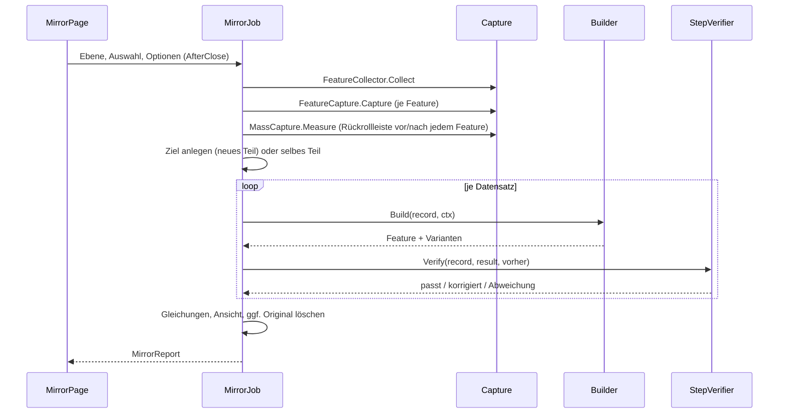

# Architektur

## Grundidee

SOLIDWORKS kennt nur abhängiges Spiegeln: Ein Spiegel-Feature verweist auf seine Quelle und rechnet bei jeder Änderung nach. Spiegelwerk verwendet keine Spiegel-API (`InsertMirrorFeature`, `MirrorPart`, abgeleitete Teile), sondern liest jedes Feature des Originals als **Daten** und erzeugt daraus mit den gewöhnlichen Methoden von `FeatureManager` und `SketchManager` ein neues Feature an gespiegelter Lage.

Der Lauf hat drei streng getrennte Phasen:



1. **Erfassen** (`Capture/`): Feature-Auswahl, Skizzen und Feature-Definitionen werden in neutrale Datensätze übersetzt. Bezüge auf Geometrie (Kanten einer Verrundung, Fläche einer „bis Fläche“-Endbedingung, Drehachse) werden als **geometrischer Fingerabdruck** gespeichert, nicht als SOLIDWORKS-Objekt. Für die spätere Prüfung wird gemessen, was jedes Feature am Volumen geändert hat.
2. **Aufbauen** (`Build/`): Jeder Datensatz wird gespiegelt im Ziel erzeugt. Nach dieser Phase wird das Original nicht mehr angefasst – im Ziel kann es daher keinen Verweis darauf geben.
3. **Prüfen** (`Build/StepVerifier`): Nach jedem Feature wird die Volumen- und Schwerpunktänderung mit der gespiegelten Änderung des Originals verglichen. Weicht sie ab, werden die vom Builder angebotenen Varianten (Richtung umkehren, Wandseite wechseln …) durchprobiert und die passende behalten.

Alles, was sich ohne SOLIDWORKS rechnen lässt, liegt in `Spiegelwerk.Core` (netstandard2.0) und ist mit Unit-Tests abgesichert. Das Add-In (`Spiegelwerk`, .NET Framework 4.8) übersetzt nur zwischen SOLIDWORKS und diesen Typen.

## Klassen

### Spiegelwerk.Core

| Namespace | Klasse | Aufgabe |
| --- | --- | --- |
| `Geometry` | `Vec3`, `Plane3`, `Line3`, `Frame3`, `Affine`, `Reflection`, `Tol` | Punkte, Ebenen, Koordinatensysteme; die Spiegelung `R(p) = p − 2((p − p₀)·n)n`; Toleranzen |
| `Sketch` | `SketchModel`, `SkPoint`, `SkSegment`, `SkRelation`, `SkDimension`, `SkRef` | Neutrale Skizze: Punkte mit IDs, Segmente verweisen auf Punkte, Beziehungen/Bemaßungen auf Punkte und Segmente oder auf externe Bezüge |
| | `SketchMirror`, `AxisMap` | Spiegelt eine Skizze in ein gegebenes Ziel-Koordinatensystem, rechnet Beziehungen und Bemaßungen um |
| `Planning` | `DirectionRules` | σ und die Regeln für Richtungsflags und Bogensinn |
| | `PlaneClassifier` | Welche Ebene trägt die gespiegelte Skizze: vorhandene, versetzte Standardebene oder Drei-Punkte-Ebene |
| | `ComponentPlacement` | Platzierung des gespiegelten Teils in der Baugruppe |
| `Matching` | `EdgeSignature`, `FaceSignature`, `TopologyMatcher` | Fingerabdrücke und deren Zuordnung im neu aufgebauten Teil |
| `Verification` | `MassState`, `MassComparison` | Volumen und erstes Moment, gespiegelt und verglichen |
| `Records` | `FeatureRecord` und Ableitungen, `GeometryRef`, `MirrorOptions`, `MirrorReport` | Erfasste Features, Optionen, Bericht |

### Spiegelwerk (Add-In)

| Ordner | Klasse | Aufgabe |
| --- | --- | --- |
| `Addin/` | `SpiegelwerkAddin` | `ISwAddin`, COM-Registrierung, Befehlsgruppe und Registerkarte |
| | `IconFactory` | Zeichnet das Befehlssymbol zur Laufzeit in allen Größen |
| `UI/` | `MirrorPage` | PropertyManager-Seite (`IPropertyManagerPage2Handler9`) |
| | `ReportForm` | Ergebnisliste |
| `Sw/` | `SwMath` | `MathTransform` ↔ `Frame3`/`Affine`, Skizzen- und Ebenenkoordinaten |
| | `SwDoc`, `SwSelect` | Feature-Baum, Standardebenen, Körper, Massen; Auswahl mit Markierung |
| | `SwPreferences`, `SketchInputScope`, `UpdateFreeze` | Benutzereinstellungen und Anzeige während des Laufs abschalten und wiederherstellen |
| `Capture/` | `FeatureCollector` | Welche Features, in Erstellungsreihenfolge |
| | `SketchCapture` | `ISketch` → `SketchModel` |
| | `FeatureCapture` | Feature-Definitionen → `FeatureRecord` (mit `AccessSelections`) |
| | `TopologyCapture` | Kante/Fläche/Eckpunkt → Fingerabdruck |
| | `MassCapture` | Volumenänderung jedes Features über die Rückrollleiste |
| `Build/` | `MirrorJob` | Der ganze Lauf; neues Teil anlegen, Gleichungen kopieren, Original löschen |
| | `BuildContext`, `SketchMap` | Zustand des Laufs; Zuordnung alter → neuer Skizzenelemente |
| | `PlaneResolver` | Liefert für eine Ebene ein Ebenen-Feature im Ziel |
| | `TopologyFinder` | Findet Kanten, Flächen, Eckpunkte und Achsen im Ziel |
| | `SketchBuilder` | Schreibt eine gespiegelte Skizze |
| | `Builders/*` | Ein Builder je Feature-Typ: Skizze, Ebene, Extrusion, Rotation, Verrundung, Fase |
| | `StepVerifier` | Messen, Varianten probieren |
| `AssemblyContext/` | `AssemblyMirror` | Komponente spiegeln, speichern, platzieren |

## Ablauf im Detail



**Reihenfolge:** `SwDoc.FeaturesInCreationOrder` liefert absorbierte Skizzen vor dem Feature, das sie verbraucht – in dieser Reihenfolge wurden sie auch erzeugt. Ein Feature findet beim Neuaufbau deshalb immer schon die Skizzen, Ebenen und Kanten vor, die es braucht.

**Auswahl:** Ohne Auswahl wird das ganze Teil gespiegelt. Gewählte Features nehmen nur die Skizzen mit, aus denen sie gebaut sind – eine gespiegelte Tasche soll den vorhandenen Körper schneiden, nicht den Körper, aus dem sie geschnitten wurde, noch einmal aufbauen. Gewählte Körper nehmen alle Features mit, die zu ihnen beigetragen haben (`IBody2.GetFeatures`).

## Die Mathematik

### Spiegelung und σ

Die Spiegelung an der Ebene (p₀, n) ist `R(p) = p − 2((p − p₀)·n)n`. Sie ist längen- und winkeltreu, aber **orientierungsumkehrend**: `R(a) × R(b) = −R(a × b)`. Daraus folgt alles Weitere.

Eine Skizze auf der Ebene S mit Normale z landet auf R(S). Auf welcher Ebene im Ziel skizziert wird und wie SOLIDWORKS deren Skizzenachsen legt, entscheidet nicht Spiegelwerk; die Ziel-Normale z′ ist entweder R(z) oder −R(z). Das Vorzeichen

    σ = sign(z′ · R(z))

steuert alle Richtungsfragen (`DirectionRules`):

| | σ = +1 | σ = −1 |
| --- | --- | --- |
| 2D-Abbildung in der Skizze | Spiegelung | Drehung |
| Bogensinn | umgekehrt | gleich |
| „Richtung umkehren“ (Extrusion) | gleich | umgekehrt |

Beispiel: Skizze auf der Ebene *vorne*, gespiegelt an *rechts*: Ziel ist wieder *vorne*, σ = +1, x-Koordinaten wechseln das Vorzeichen, Bögen laufen andersherum, die Extrusion geht in dieselbe Richtung. Skizze auf *rechts*, gespiegelt an *rechts*: dieselbe Ebene, aber R(z) = −z, also σ = −1 – die 2D-Koordinaten bleiben gleich, die Extrusion muss umgedreht werden.

Ob SOLIDWORKS einen Aufsatz entlang und einen Schnitt entgegen der Normale extrudiert, spielt dabei keine Rolle: Die Konvention gilt für Original und Kopie gleichermaßen und kürzt sich heraus (Test `Extrude_direction_follows_the_mirror_for_every_plane_combination`).

### Prüfung über Volumen und erstes Moment

Volumen V und erstes Moment M = Σ Vᵢ·cᵢ aller Volumenkörper sind additiv; die Änderung durch ein Feature ist „nachher − vorher“. Für die gespiegelte Änderung braucht man die Körper nicht:

    V′ = V,    M′ = M − 2((M − V·p₀)·n)n

`MassComparison` vergleicht Volumen und Moment getrennt – relativ zur Größe der Änderung (1e-4 beim Volumen, 10 µm beim Schwerpunkt), aber nie feiner als das Rauschen, das aus dem ganzen Teil folgt. Getrennt deshalb, weil eine Änderung mit dem Nettovolumen null (eine Verrundung, die innen ansetzt und außen wegnimmt) trotzdem ein klares Moment hat. Damit wird aus „in welche Richtung legt SOLIDWORKS das standardmäßig?“ eine Messung; eine Variante, die das Feature in einen Fehlerzustand bringt, gewinnt dabei nie.

### Baugruppe

Original-Komponente: Teilgeometrie x, Platzierung T. Gewünscht ist R_asm(T(x)). Das neue Teil wird als R_part(x) gebaut. Die Platzierung T′ muss T′(R_part(x)) = R_asm(T(x)) erfüllen:

    T′ = R_asm ∘ T ∘ R_part

Zwei Spiegelungen und eine starre Bewegung ergeben Determinante +1 – eine gültige Komponententransformation. Weil R_part frei wählbar ist, spiegelt Spiegelwerk das Teil an **seiner eigenen** Standardebene durch den Ursprung, deren Normale der Baugruppen-Spiegelebene am nächsten liegt. Das neue Teil sieht dann aus wie ein konstruiertes Gegenstück (Skizzen auf vorne/oben/rechts) und nicht wie eine irgendwo im Raum verschobene Kopie (`ComponentPlacement`, Test `Component_placement_puts_the_mirrored_part_where_the_mirror_image_is`).

## Ebenen im Ziel

`PlaneResolver` liefert für jede gespiegelte Skizzenebene ein Ebenen-Feature, das **nicht** vom Original abhängt:

1. Fällt sie mit einer vorhandenen Ebene zusammen (Standardebene oder eine schon angelegte), wird diese verwendet – egal mit welcher Normalenrichtung; σ fängt das ab.
2. Ist sie parallel zu einer Standardebene, entsteht eine Versatzebene davon. Die Seite des Versatzes wird nachgemessen und bei Bedarf umgedreht.
3. Sonst entsteht eine Ebene durch drei fixierte Punkte einer Hilfs-3D-Skizze („Spiegelwerk-Anker“).

Die Standardebenen werden über ihre Geometrie gefunden, nicht über den Namen („Ebene vorne“, „Front Plane“ …).

## Kanten und Flächen wiederfinden

Kanten und Flächen haben keine dokumentübergreifende Identität. Spiegelwerk speichert beim Erfassen einen Fingerabdruck (`EdgeSignature`: Kurventyp, Endpunkte, Punkt in Parametermitte, Länge, bei Kreisen Mittelpunkt/Radius/Achse; `FaceSignature`: Flächentyp, Inhalt, ein Punkt auf der Fläche, bei Ebenen die Außennormale). Gelesen wird während `AccessSelections` – dann ist das Modell auf den Stand des Features zurückgerollt, und eine Kante, die später von einer Verrundung geteilt wird, ist noch ganz.

Beim Aufbau wird der gespiegelte Fingerabdruck im Ziel gesucht (`TopologyMatcher`). Das Ziel befindet sich in diesem Moment genau im gespiegelten Zustand des Originals, deshalb passt die Suche exakt. Zwei Halbkreise mit gleichen Endpunkten unterscheidet der Mittelpunkt; gibt es dieselbe Kante zweimal (selbes Teil, Kante auf der Spiegelebene), gewinnt der Körper, den der Lauf selbst erzeugt hat. Geschlossene Kanten haben eine Naht, die der Kern frei wählt: Vollkreise werden deshalb über Mittelpunkt, Radius und Achse verglichen, geschlossene Ellipsen und Splines über den Abstand der gespiegelten Punkte zur Kandidatenkurve, den der Kern misst. Bezüge, die vor dem Erzeugen eines Features gefunden werden, gehen als „sichere“ Entitäten (`GetSafeEntity`) über den Neuaufbau.

Findet sich eine ebene Bezugsfläche nicht, wird eine Ebene durch die gespiegelte Fläche verwendet; „bis Fläche“ auf eine zur Skizze parallele Ebene kann auch in die gleichwertige feste Tiefe umgewandelt werden.

## Selbes Teil

Wird das ganze Teil oder ein Körper im selben Teil gespiegelt, entsteht ein eigener Körper. Aufsätze werden zunächst ohne Verschmelzen erzeugt; Verschmelzen und Feature-Bereich setzt dann ein einziges `ModifyDefinition`, und zwar mit den Körpern aus dem zurückgerollten Zustand vor dem Feature – dort gibt es den gespiegelten Körper noch für sich, nie schon mit dem Original verschmolzen. Schnitte wirken nur auf die vom Lauf erzeugten Körper; gibt es noch keinen, wird der Schnitt gar nicht angelegt. Lässt sich der Feature-Bereich nicht setzen, wird das Feature wieder entfernt. So schneidet oder verschmilzt ein gespiegeltes Feature nie mit dem Original, auch wenn sich beide berühren – ein Fall, den der Volumenvergleich nicht sehen könnte. Feature-Namen bekommen den Namenszusatz.

Ebenen des Originals verwendet der `PlaneResolver` im selben Teil nicht: Er kennt nur die Standardebenen und die Ebenen, die der Lauf selbst anlegt.

„Original löschen“ wird nur ausgeführt, wenn jedes Feature ein fehlerfreies Gegenstück hat (`MirrorReport.AllMirrored` – übersprungene Achsen, 3D-Skizzen oder Koordinatensysteme blockieren) und kein anderes Feature vom Original abhängt.

## Einen Feature-Typ ergänzen

Ein neuer Typ braucht drei Teile:

1. **Datensatz** in `Spiegelwerk.Core/Records/FeatureRecords.cs` – nur Zahlen, Flags und `GeometryRef`/Signaturen, keine SOLIDWORKS-Objekte.
2. **Erfassen** in `FeatureCapture.Capture`: Definition lesen, Bezüge zwischen `AccessSelections` und `ReleaseSelectionAccess` in Fingerabdrücke übersetzen.
3. **Builder** in `Build/Builders/` und Eintrag in `MirrorJob.Builders`.

Skizze eines linearen Musters:

```csharp
internal sealed class LinearPatternBuilder : IFeatureBuilder
{
    public bool Handles(FeatureRecord r) => r is LinearPatternRecord;

    public BuildResult Build(FeatureRecord record, BuildContext ctx)
    {
        var r = (LinearPatternRecord)record;
        // Saat-Features: über den Namen des Originals das neu erzeugte Feature holen.
        var seeds = r.SeedFeatures.Select(n => ctx.Created.TryGetValue(n, out var f) ? f : null).ToList();
        if (seeds.Any(s => s == null)) return BuildResult.Failed("Saat-Feature nicht neu aufgebaut.");
        // Richtung: gespiegelte Gerade, im Ziel als Skizzenlinie oder gerade Kante gesucht.
        object? dir1 = ctx.Topology.FindLineObject(ctx.Mirror.Apply(r.Direction1));
        // ... Richtung (Markierung 1) und Saat-Features (Markierung 4) wählen – so die
        //     Beispiele der API-Hilfe; im Zweifel nach dem Erzeugen per ModifyDefinition setzen,
        //     FeatureManager.FeatureLinearPattern5(...) aufrufen,
        //     "Richtung umkehren" als Alternative anbieten (die gespiegelte Richtung kann
        //     auf der Gegenseite der Kante liegen).
        ...
    }
}
```

Eine Spiegelung kehrt jede Drehrichtung um: Bei Kreismustern muss die Winkelrichtung umgedreht werden, bei Austragungen mit Verdrehung der Drehsinn, beim Bohrungsassistenten bleibt das Bohrbild (Positionsskizze) eine gewöhnliche Skizze und läuft durch `SketchBuilder`.
