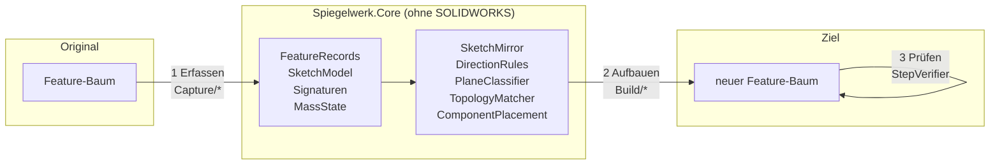
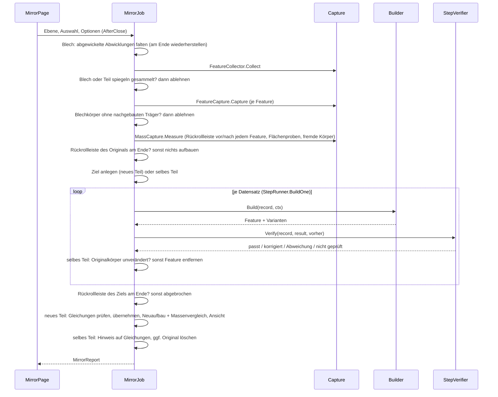

# Architektur

## Grundidee

SOLIDWORKS kennt nur abhängiges Spiegeln: Ein Spiegel-Feature verweist auf seine Quelle und rechnet bei jeder Änderung nach. Spiegelwerk verwendet keine Spiegel-API (`InsertMirrorFeature`, `MirrorPart`, abgeleitete Teile), sondern liest jedes Feature des Originals als **Daten** und erzeugt daraus mit den gewöhnlichen Methoden von `FeatureManager` und `SketchManager` ein neues Feature an gespiegelter Lage. Das gilt auch für Spiegel-Features im Original: Ihre zweite Hälfte entsteht als gewöhnliche Features (siehe [Spiegel-Features](#spiegel-features)).

Der Lauf hat drei streng getrennte Phasen:



1. **Erfassen** (`Capture/`): Feature-Auswahl, Skizzen und Feature-Definitionen werden in neutrale Datensätze übersetzt. Bezüge auf Geometrie (Kanten einer Verrundung, Fläche einer „bis Fläche“-Endbedingung, Drehachse) werden als **geometrischer Fingerabdruck** gespeichert, nicht als SOLIDWORKS-Objekt. Ausgewählte Konturen einer Extrusion oder Rotation werden als Mengen von Segment-IDs erfasst, ausgewählte Skizzenbereiche als abgetasteter Rand mit Punkten in ihrem Inneren (siehe [Skizzenbereiche](#skizzenbereiche)) – alles oder nichts: Ist ein Element nicht lesbar, bleibt keines. Für die spätere Prüfung wird gemessen, was jedes Feature am Volumen geändert hat.
2. **Aufbauen** (`Build/`): Jeder Datensatz wird gespiegelt im Ziel erzeugt. Nach dieser Phase wird das Original nicht mehr angefasst – im Ziel kann es daher keinen Verweis darauf geben.
3. **Prüfen** (`Build/StepVerifier`): Nach jedem Feature wird die Volumen- und Schwerpunktänderung mit der gespiegelten Änderung des Originals verglichen. Weicht sie ab, werden die vom Builder angebotenen Varianten (Richtung umkehren, Wandseite wechseln …) durchprobiert und die passende behalten. Lässt sich eine verworfene Variante nicht zurückschalten, bleibt sie: Gemessen und gemeldet wird dieser Zustand, weitere Varianten werden nicht probiert. Ließ sich das Original für ein Feature nicht zurückrollen, fehlt die Referenz; die Prüfung lautet dann „nicht geprüft“, und der Schritt ist ein Hinweis.

Alles, was sich ohne SOLIDWORKS rechnen lässt, liegt in `Spiegelwerk.Core` (netstandard2.0) und ist mit Unit-Tests abgesichert. Das Add-In (`Spiegelwerk`, .NET Framework 4.8) übersetzt nur zwischen SOLIDWORKS und diesen Typen. Damit Core ohne SOLIDWORKS baut, führt es die nötigen swconst-Zahlen selbst: `EndCondition`, `StartCondition`, `Tangency`, `TwistControl`, `DraftKind`, `FaceFilletKind`, `HoleTypes`, `AdvancedHoleTypes`, `RevolveTypes`. `SwConstTests` prüft sie per Namen gegen das NuGet-Paket SolidWorks.Interop.swconst 32.1.0, das das Testprojekt nur dafür referenziert. 27.3.0 ließe sich unter net8.0 nur mit `NoWarn` NU1701 laden; die Zahlen sind in beiden Versionen gleich.

## Klassen

### Spiegelwerk.Core

| Namespace | Klasse | Aufgabe |
| --- | --- | --- |
| `Geometry` | `Vec3`, `Plane3`, `Line3`, `Frame3`, `Affine`, `Reflection`, `Tol` | Punkte, Ebenen, Koordinatensysteme; die Spiegelung `R(p) = p − 2((p − p₀)·n)n`, auch aus einer Transformation zurückgewonnen (`Reflection.TryFromAffine`, keine Gleitspiegelung); Toleranzen |
| `Sketch` | `SketchModel`, `SkPoint`, `SkSegment`, `SkRelation`, `SkDimension`, `SkRef` | Neutrale Skizze: Punkte mit IDs, Segmente verweisen auf Punkte, Beziehungen/Bemaßungen auf Punkte und Segmente oder auf externe Bezüge |
| | `SketchMirror`, `AxisMap` | Spiegelt eine Skizze in ein gegebenes Ziel-Koordinatensystem, rechnet Beziehungen und Bemaßungen um; `MapPoint` ist der Weg jedes Punkts (Quellskizze → Modell → Spiegelung → Zielskizze) |
| | `ProfileRegion`, `RegionGeometry`, `RegionSpace`, `RegionMatcher` | Skizzenbereiche: Rand als ungeordnete Segmentmenge, Innenpunkte, Fläche; in welchen Koordinaten SOLIDWORKS die Kanten liefert; Zuordnung in der gespiegelten Skizze und Prüfung des fertigen Features |
| `Planning` | `DirectionRules` | σ und die Regeln für Richtungsflags und Bogensinn |
| | `PlaneClassifier` | Welche Ebene trägt die gespiegelte Skizze: vorhandene, versetzte Standardebene oder Drei-Punkte-Ebene |
| | `ComponentPlacement` | Platzierung des gespiegelten Teils in der Baugruppe |
| | `PatternInstances` | Lage der Musterinstanzen spiegeln (R ∘ T ∘ R) und als Mengen vergleichen; Verschiebungen eines Skizzenmusters |
| | `TablePoints` | Punkte eines Tabellenmusters im gespiegelten Koordinatensystem (x, y, −z) |
| | `FillPatternRules` | Füllmuster: Versatzwinkel π − θ, Gegendrehung des Saat-Schnitts, symmetrische Gitter |
| | `HoleAxis` | Wo eine Bohrungsachse den Körper verlässt (fernseitige Fläche der erweiterten Bohrung) |
| | `BodyScope` | Körperverlauf aus `IBody2.GetFeatures`: welche mitgespiegelten Features auch Körper verändern, die die Kopie nicht bekommt, und welche nicht gewählten Körper aus ihnen entstehen |
| | `ProfileRules` | Profil aus Konturen und Skizzenbereichen: Wege der Übergabe beim Anlegen, Rückfallregel (ganze Skizze, im selben Teil mit nur gewählten Features kein Feature), Berichtstexte |
| | `FeatureNames` | Freier Feature-Name: der gewünschte, sonst mit „ (2)“, „ (3)“ …; der eigene Name zählt nicht als Kollision |
| | `EquationText` | Namen in Gleichungen: genannte Bemaßungen und Variablen, linke Seite |
| | `RunSteps` | Schritte und Titel des Fortschrittsbalkens, Berichtszeilen zum Abbruch mit Esc, Besitzer, deren Teile nach Esc zurückgenommen werden |
| | `UnsupportedFeatures` | Berichtstexte für nicht unterstützte Feature-Typen (`GetTypeName2`) und für Feature-Daten, die nicht antworten (auch bei Spiegel-Features); welche Typen den Volumenkörper ändern (`ChangesSolid`); Blech und „Teil spiegeln“ lehnen den ganzen Lauf vor dem Erfassen ab (`RefusesBeforeCapture`, für die gesammelten Features `RefusalBeforeCapture` samt Besitzern und – bis S1b – Blech im selben Teil, Meldungen `RunRefusal`, `SamePartRefusal`) |
| | `SheetMetalTypes` | Blech-Typen mit Rolle (System, Teil, Träger, Blatt) und Zustand (noch nicht, nachgebaut, nicht unterstützt); wann ein Blech-Typ den Lauf ablehnt (siehe [Blech](#blech)) |
| | `SheetMetalTree` | Wer in einem Blechteil mit wem entsteht: Blech-Feature → Basislasche, Skizzen und eigene Ecken → Abwicklung, Abwicklung → Basislasche ihres Körpers; was eine Auswahl mitbringt (`Closure`), Ecke trimmen des Anwenders, Features hinter der Abwicklung, welche Unter-Features die Erstellungsreihenfolge listet |
| | `SheetMetalRules` | Basislasche: Seiten (`BaseFlangeFlags`, `InPlaneSideFlag`), Endbedingungen (`FromFlangeOffset`/`ToFlangeOffset`), Werte beim Anlegen (`CreationValues`), Körperzahl, Reihenfolge der Wege, Überschreiben-Flags; Berichtstexte der Abwicklung |
| | `SheetMetalPlanner` | Zweite Stufe der Ablehnung nach dem Erfassen: ein Blechkörper, dessen Träger nicht nachgebaut wird (`Refusal`) |
| | `SheetMetalCompare`, `AllowanceRules`, `BendOverrides` | Blech-Werte vergleichen (Toleranzen, gefaltete Winkel, Tabellenpfade), Reihenfolge beim Schreiben einer eigenen Biegezugabe, eigene Werte einzelner Biegungen als Hinweise |
| | `MirrorFeatureRules`, `StepCheck` | Spiegel-Features: Spiegelung der zweiten Hälfte R_P′, Namen, Unabhängigkeit der Saat und Prüfart der Schritte, Proben auf P′, erwartete Körper, ganze Flächensätze, verschachtelte „Körper spiegeln“, Verschmelzen-Flag, Status und Berichtstexte |
| | `BodyMaterials` | Hinweis auf Werkstoffe einzelner Körper, die nicht übernommen werden |
| `Matching` | `EdgeSignature`, `FaceSignature`, `TopologyMatcher` | Fingerabdrücke und deren Zuordnung im neu aufgebauten Teil |
| | `DimensionMatcher` | Gegenstücke der Feature-Bemaßungen in der Kopie (Name, Art, Wert) und die Umbenennungen dazu |
| `Verification` | `MassState`, `MassComparison` | Volumen und erstes Moment, gespiegelt und verglichen |
| `Records` | `FeatureRecord` und Ableitungen (`SweepLoftRecords.cs`, `PatternRecords.cs` (linear, kreisförmig, Kurve, Skizze, Tabelle, Füll-, variables Muster), `CoordSysRecord` in `FeatureRecords.cs`, `HoleRecords.cs` mit den gemeinsamen Basen `PositionedFeatureRecord` und `PositionedHoleRecord`, `PartOfFeatureRecord` samt Art des Besitzers (`PartOwnerKind`) und der Typzuordnung `HoleTypes`, `SheetMetalRecords.cs` mit den gemeinsamen Blech-Werten (Biegezugabe, Entlastung, Blechstärkentabelle, Blechparameter, Werte einer Biegung) und `BaseFlangeRecord` (mit `FlangeSide`), `FlatPatternRecord`, `AdvancedHoleRecords.cs`, `ShellDraftRecords.cs`, `VariableFilletRecords.cs` mit `EdgeLocation`, `FaceFilletRecords.cs`, `MirrorFeatureRecords.cs` mit `MirrorFeatureRecord`, `MirrorSeedBody` und `BuiltFeature`), `GeometryRef`, `MirrorOptions`, `MirrorReport` (mit `Nested` für die Schritte einer zweiten Hälfte) | Erfasste Features samt Flächenproben, Optionen, Bericht |
| | `ReportText` | Geometrie in Berichtszeilen: Ebene in mm, Zahlen im Format der aktuellen Kultur |

### Spiegelwerk (Add-In)

| Ordner | Klasse | Aufgabe |
| --- | --- | --- |
| `Addin/` | `SpiegelwerkAddin` | `ISwAddin`, COM-Registrierung, Befehlsgruppe und Registerkarte |
| | `IconFactory` | Zeichnet das Befehlssymbol zur Laufzeit in allen Größen |
| `UI/` | `MirrorPage` | PropertyManager-Seite (`IPropertyManagerPage2Handler9`) |
| | `ReportForm` | Ergebnisliste, nicht modal; Enter und Tab über `KeyPreview` |
| `Sw/` | `SwMath` | `MathTransform` ↔ `Frame3`/`Affine`, Skizzen- und Ebenenkoordinaten |
| | `SwDoc`, `SwSelect`, `ContourSelectionScope` | Feature-Baum, Rückrollleiste ans Ende (`RollToEnd`), Standardebenen, Körper, Massen; Auswahl mit Markierung; Konturauswahl für die Dauer einer Auswahl einschalten und auf den vorigen Wert zurücksetzen |
| | `SwPattern` | Lage der Instanzen eines Musters lesen (`GetTransform`) |
| | `SwHole` | Maße und Optionen einer Bohrung lesen, vergleichen, setzen; Positionsskizze finden |
| | `SwAdvancedHole` | Elemente einer erweiterten Bohrung lesen, anlegen, vergleichen, setzen; Positionsskizze finden |
| | `SwSheetMetal` | Blech im Dokument: Ordnerinhalt, Baum für `SheetMetalTree`, Snapshot und `NewSince`/`RemoveNew` samt Ordnern, Unterdrückung (gefaltet/abgewickelt), Blechparameter lesen, schreiben (`Apply`, einziger Schreiber) und zurücklesen, Biegezugabe-Objekte |
| | `SheetMetalSession`, `SheetMetalGuard` | Abgewickelte Abwicklungen für den Lauf falten und wiederherstellen, den Kopien den Zustand geben; die gemeinsamen Blech-Werte des Ziels vor einem Schritt festhalten, vergleichen, zurückschreiben oder abbrechen |
| | `SwLate` | Spät gebundener Zugriff auf API-Teile, die erst neuere Versionen haben: Eigenschaften lesen und setzen, Methoden mit Ergebnis (`Invoke`) und mit Rückgabe über Referenzparameter (`InvokeOut`) |
| | `SwPreferences`, `SketchInputScope`, `UpdateFreeze` | Benutzereinstellungen und Anzeige während des Laufs abschalten und wiederherstellen |
| | `RunProgress` | Fortschrittsbalken in der Statusleiste (`IUserProgressBar`), Esc zwischen zwei Features und zwischen zwei Schritten einer zweiten Hälfte (`CancelWithinStep`), Esc mit dem letzten Schritt (`EscAtEnd`) |
| `Capture/` | `FeatureCollector` | Welche Features, in Erstellungsreihenfolge (Abwicklungen in ihrem Ordner und was unter einer Abwicklung liegt eingeschlossen); eine gewählte Basislasche mit Blech-Feature und Abwicklung (`SheetMetalTree.Closure`); Abwicklung und ihre Unter-Features werden nicht als unterdrückt übersprungen, Features hinter der Abwicklung schon; bei gewählten Körpern und Saat-Körpern dazu der `BodyScope`; `SolidFeatures` als gemeinsame Regel für Körperverlauf und Vermessung; für die zweite Hälfte eines Spiegel-Features die eigenen Kopien im Ziel (`CollectCopies`) |
| | `SketchCapture` | `ISketch` → `SketchModel` |
| | `FeatureCapture` (+ `.SweepLoft`, `.Patterns`, `.Holes`, `.AdvancedHole`, `.ShellDraft`, `.VariableFillet`, `.FaceFillet`, `.Mirror`, `.SheetMetal`) | Feature-Definitionen → `FeatureRecord` (mit `AccessSelections`); `CaptureAll` samt Teilen ihrer Besitzer (Skizzen von Bohrungen, Blech-Feature einer Basislasche, Skizzen und eigene Ecken einer Abwicklung); jeder Blech-Typ über einen ausnahmesicheren Verteiler (`CaptureSheetMetal`; Basislasche, Abwicklung; feste Referenzen nur als Fläche oder Kante, `FaceOrEdgeRef`); im Kopiermodus (`ofOwnCopy`) die eigenen Kopien im Ziel; ausgewählte Skizzenbereiche über `RegionCapture`, mit der `RegionSpaceMemory` des Laufs |
| | `TopologyCapture` | Kante/Fläche/Eckpunkt → Fingerabdruck |
| | `RegionCapture` | Skizzenbereich → `ProfileRegion` (Kanten mit den Kurven von SOLIDWORKS abgetastet, Koordinatenraum entschieden, mit der Fläche des Kerns abgeglichen); im Original, in der Kopie und beim Zurücklesen |
| | `MassCapture` | Volumenänderung und Flächenproben jedes Features über die Rückrollleiste (bis `MeasureUntil`); bei einer Abwicklung, was das Abwickeln ändert (`FlatChange`); bei gewählten Körpern und Saat-Körpern Änderungen fremder Körper (`ForeignRule`) |
| `Build/` | `MirrorJob` | Der ganze Lauf; Startprüfung (offene Skizze, Rückrollleiste), Blech-Sitzung (falten, am Ende wiederherstellen), Ablehnung vor dem Erfassen (Blech-Typen, „Teil spiegeln“) und nach dem Erfassen (Blechkörper ohne nachgebauten Träger), Erfassen, Rückrollleiste nach dem Erfassen und nach dem Aufbau, neues Teil anlegen, Gleichungen prüfen und kopieren, Original löschen |
| | `StepRunner` | Ein Schritt: Builder (Liste `Builders`), Prüfung, Prüfung der Originalkörper, Wächter der Blech-Werte, Aufräumen nach einer Ausnahme im Builder (samt Ordnerinhalt), Bemaßungsnamen zurückgeben (auch der Begleiter), Berichtseintrag – für den Lauf und für jeden Schritt einer zweiten Hälfte |
| | `BuildContext`, `BuildShared`, `SketchMap` | Zustand des Laufs (und einer zweiten Hälfte, `Nested`); was alle Kontexte teilen: `PlaneResolver`, eigene Features, Alter der Topologie, Bekanntes über jedes aufgebaute Feature (`Built`); was der Lauf über den Koordinatenraum von Skizzenbereichen weiß (`RegionSpaces`, mit `FeatureCapture` geteilt, `Nested` übernimmt sie vom Elternkontext); Zuordnung alter → neuer Skizzenelemente; Blechkörper der Kopie je Basislasche (`SheetMetalBodies`), Wächter und Sitzung (`BuildShared`) |
| | `PlaneResolver` | Liefert für eine Ebene ein Ebenen-Feature im Ziel, für eine Gerade eine Achse, für einen Rahmen ein Koordinatensystem |
| | `TopologyFinder` | Findet Kanten, Flächen, Eckpunkte, Achsen und Skizzen im Ziel |
| | `SketchBuilder` | Schreibt eine gespiegelte Skizze – neu oder in eine vorhandene (Positionsskizze einer Bohrung) |
| | `Builders/*` | Ein Builder je Feature-Typ: Skizze, Ebene, Achse, Extrusion, Rotation, Austragung, Ausformung, Verrundung, variable Verrundung, Flächen- und vollständige Verrundung, Fase, Wandung, Formschräge, Bohrung, erweiterte Bohrung, Muster (linear/kreisförmig, Kurve, Skizze, Tabelle, Füll-, variables Muster; gemeinsame Bausteine in `PatternSupport`), Koordinatensystem, Spiegel-Features (`MirrorFeatureBuilder`), Basislasche (`BaseFlangeBuilder`), Abwicklung (`FlatPatternBuilder`); Profil aus Konturen und Skizzenbereichen für Extrusion und Rotation in `ProfileSupport` |
| | `StepVerifier` | Messen (Volumen, Moment, Flächenproben), Varianten probieren |
| `AssemblyContext/` | `AssemblyMirror` | Komponente prüfen, spiegeln, speichern, platzieren; Leichtgewicht wiederherstellen |

## Ablauf im Detail



**Start:** `MirrorJob.Run` beginnt nur, wenn keine Skizze zur Bearbeitung geöffnet ist und die Rückrollleiste am Ende des Feature-Baums steht. In einer offenen Skizze scheitert das Zurückrollen für die Messung, und die erste neue Skizze würde die des Anwenders schließen, statt eine eigene zu öffnen.

**Abgelehnte Teile:** Ist unter den gesammelten Features ein Blech-Feature, das noch kein Schritt nachbaut, oder „Teil spiegeln“ (`MirrorStock`), lehnt `MirrorJob` den Lauf vor dem Erfassen ab (`UnsupportedFeatures.RefusalBeforeCapture`; welche Blech-Typen das sind, steht in `SheetMetalTypes`, siehe [Blech](#blech)); bis S1b ebenso jeden Lauf mit Blech im selben Teil. Nach dem Erfassen lehnt er einen Lauf ab, der einen Blechkörper aufbauen würde, dessen Träger nicht nachgebaut wird (`SheetMetalPlanner.Refusal`). Solche Features werden nicht nachgebaut, und das erste davon trägt oft den Grundkörper: Alles danach scheiterte ebenfalls, und in einer Baugruppe würde ein leeres Gegenstück gespeichert und eingefügt. Die Meldung (`RunRefusal`) endet mit „Es wurde nichts gespiegelt.“; bei „Teil spiegeln“ nennt sie die Abhilfe. In einer Baugruppe steht die Komponente als fehlgeschlagen im Bericht („nicht gespiegelt – …“), gespeichert und eingefügt wird nichts.

**Reihenfolge:** `SwDoc.FeaturesInCreationOrder` sortiert nach Abhängigkeiten (`CreationOrder`): absorbierte Skizzen vor dem Feature, das sie verbraucht, und jedes Feature nach seinen Eltern – wo auch immer diese im Baum stehen. Der Baum allein reicht nicht: Eine Ausformung zeigt ihre Profilskizzen unter sich, eine später gezeichnete Führungskurve mit Beziehungen zu den Profilen steht aber oben im Baum, vor der Ausformung. Ein Feature findet beim Neuaufbau so immer schon die Skizzen, Ebenen und Kanten vor, die es braucht; ein unveränderter Baum bleibt in seiner Reihenfolge (Tests in `CreationOrderTests`).

**Auswahl:** Ohne Auswahl wird das ganze Teil gespiegelt. Gewählte Features nehmen nur die Skizzen mit, aus denen sie gebaut sind – eine gespiegelte Tasche soll den vorhandenen Körper schneiden, nicht den Körper, aus dem sie geschnitten wurde, noch einmal aufbauen. Gewählte Körper nehmen alle Features mit, die zu ihnen beigetragen haben (`IBody2.GetFeatures`). Ein gewähltes Muster nimmt seine Saat mit – ohne sie hätte es nichts zu wiederholen: die Saat-Features, bei Flächenmustern die Features, zu denen die Flächen gehören, bei Körpermustern die Features, aus denen die Körper entstanden sind. Wie bei gewählten Körpern entsteht im selben Teil dann ein eigener Körper, sonst verschmölze die gespiegelte Saat mit dem Original. Ein Muster ohne auffindbare Saat scheitert, bevor eine Hilfsachse oder -ebene angelegt wird.

**Körper außerhalb der Auswahl:** Ein Feature, das ein gewählter Körper mitnimmt, kann auch andere Körper verändert haben – ein Schnitt durch zwei Körper, ein Schnitt, der einen Block in zwei teilt. Bei gewählten Körpern und Saat-Körpern liefert `FeatureCollector` deshalb einen `BodyScope`: je Volumenkörper des Originals seine Features aus `IBody2.GetFeatures` in Erstellungsreihenfolge, ohne Skizzen, Bezugsgeometrie und Unter-Features außerhalb des Baumdurchlaufs wie kosmetische Gewinde (`FeatureCollector.SolidFeatures`). Steht im Verlauf eines Körpers vor einem mitgespiegelten Feature eines, das nicht mitgespiegelt wird, hat die Kopie diesen Körper nicht so, wie das Feature ihn vorfand. Das Feature wird beim Erfassen markiert (`FeatureRecord.OtherBodies`): keine Massen- und Flächenmessung, kein Vergleich, keine Variantensuche. Stattdessen bekommt es einen Hinweis und hat damit den Status „Hinweis“, der „Original löschen“ sperrt. Der `BodyScope` stammt aus dem Endzustand und sieht keinen Körper, den es am Ende nicht mehr gibt. Deshalb prüft `MassCapture` beim Vermessen (nur mit „Jeden Schritt prüfen“) zusätzlich im zurückgerollten Zustand vor und nach jedem Feature die fremden Körper (`MassCapture.ForeignRule`): Körper mit einem Feature, das nach derselben Regel (`SolidFeatures`) Volumenkörper verändert und nicht gesammelt ist; übersprungene Features zählen wie beim `BodyScope` als gesammelt. Ändert sich dabei die Masse fremder Körper, bekommt das Feature ebenso keine Referenz und denselben Hinweis. Der Hinweis nennt nur die Körper, die das Feature verändert hat, jeden einmal. Ein Körper, der nur aus mitgespiegelten Features besteht (die andere Hälfte des geteilten Blocks), entsteht in der Kopie mit; die Prüfung über das ganze Dokument bleibt dafür gültig. Das gilt auch beim Spiegeln gewählter Körper in ein neues Teil.

**Ausnahme im Builder:** Vor jedem Schritt merkt sich `StepRunner` die Namen der Features auf oberster Ebene. Wirft ein Builder, löscht `RemoveLeftovers` alles, was der Schritt neu angelegt hat: das Feature, Hilfsebenen, -achsen, -KS und Ankerskizzen. Gelöscht wird ohne absorbierte Features: Skizzen früherer Schritte bleiben, eigene Skizzen des Schritts (etwa die Positionsskizze einer Bohrung) gehen in einer zweiten Runde mit. Vorher vergessen Registrierung, Skizzenzuordnung und `PlaneResolver` die gelöschten Features (`BuildContext.Forget`). Eine gemeinsam genutzte Skizze eines früheren Schritts steht auch unter dem neuen Feature; sie bleibt unter dem früheren im Modell und wird deshalb nicht vergessen. Der Bericht nennt, was wieder entfernt wurde und was nicht. So bleibt kein unregistriertes Feature stehen, das schon in den Originalkörper geschnitten hat.

**Fortschritt und Abbruch:** `MirrorJob.Run` läuft in einem `RunProgress`: einem Fortschrittsbalken in der Statusleiste über `ISldWorks.GetUserProgressBar`, der über `using` in jedem Fall wieder endet. Schrittzahl, Titel („Spiegelwerk – Aufbauen: Austragung1“, zum Schluss „Spiegelwerk – Abschließen“) und Abbruchhinweise liegen in Core (`RunSteps`): ein Schritt je Feature beim Erfassen, beim Vermessen (nur mit „Jeden Schritt prüfen“) und beim Aufbauen. `UpdateProgress` meldet Esc; abgefragt wird nur zwischen zwei Schritten (in der zweiten Hälfte eines Spiegel-Features auch zwischen ihren Schritten, `CancelWithinStep`), und angehalten erst nach einer Rückfrage. Beim Vermessen gibt `MassCapture.Measure` dann `false` zurück. Abgebrochen beim Erfassen oder Vermessen, wird nichts aufgebaut und kein neues Teil angelegt; beim Aufbauen hält der Lauf an wie mit „Beim ersten Fehler abbrechen“, und die Skizzen der Bohrungen, die nicht mehr aufgebaut werden, gelten nicht mehr als gespiegelt (Abschnitt „Bohrungen“). `MirrorReport.Cancelled` kennzeichnet den Abbruch durch den Anwender, `Append` übernimmt es, und in der Baugruppe wird keine weitere Komponente gespiegelt. Meldet `UpdateProgress` das Esc erst mit dem letzten Schritt, ist nichts mehr aufzubauen, und es gibt keine Rückfrage. `RunProgress` merkt es sich aber (`EscAtEnd`), und `MirrorJob.Run` trägt es als `MirrorReport.StopRequested` in den Bericht. Im selben Teil wird das Original dann nicht gelöscht („Original nicht gelöscht: Der Lauf wurde mit Esc abgebrochen.“). In einer Baugruppe ist die Komponente fertig, wird gespeichert und eingefügt, und `MirrorPage` fragt vor der nächsten, ob abgebrochen werden soll; mit „Ja“ ist der Gesamtbericht abgebrochen (`Aborted`, `Cancelled`). `Append` übernimmt `StopRequested` nicht. Ohne Fortschrittsbalken läuft alles gleich, nur ohne Abbruch. Erfassen und Vermessen (samt `FeatureCollector` und `MassCapture`) laufen unter `UpdateFreeze` des Originals, der Aufbau unter `UpdateFreeze` des Ziels; der Abschluss ist nicht eingefroren.

**Rückrollleiste nach Erfassen und Aufbau:** Esc unterbricht auch den Neuaufbau von SOLIDWORKS selbst, ein Zurückrollen eingeschlossen, und lässt die Rückrollleiste dann hinter dem Feature stehen, bei dem sie gerade war. Nach Erfassen und Vermessen setzt `SwDoc.RollToEnd` die Leiste des Originals deshalb noch einmal ans Ende und prüft, ob sie dort steht. Gelingt das nicht, wird nichts aufgebaut und kein neues Teil angelegt; der Lauf ist abgebrochen („Die Rückrollleiste des Originals ließ sich nach dem Erfassen nicht wieder ans Ende setzen …“). Nach dem Aufbau und `EditRebuild3` prüft `MirrorJob` dasselbe beim Ziel. Steht die Leiste dort nicht am Ende, gilt der Lauf als abgebrochen („Achtung: Die Rückrollleiste steht nach dem Aufbau nicht am Ende des Feature-Baums …“): In einer Baugruppe wird das neue Teil nicht gespeichert und nicht eingefügt, im selben Teil wird das Original nicht gelöscht.

**Baugruppe:** `MirrorPage` ruft `AssemblyMirror.Run` je Komponente auf. Gespiegelt werden nur Teile der obersten Ebene. `Run` löst eine leichtgewichtige Komponente für den Lauf auf und setzt sie im `finally` wieder leichtgewichtig; den Rest erledigt die private Methode `Mirror`. Der Gesamtbericht trägt den Namen der Baugruppe, `MirrorReport.Append` hängt jeden Komponentenbericht unter einer eigenen Überschrift mit der gespeicherten Datei an („— Halter-1 → Halter_gespiegelt.SLDPRT: …“).

## Die Mathematik

### Spiegelung und σ

Die Spiegelung an der Ebene (p₀, n) ist `R(p) = p − 2((p − p₀)·n)n`. Sie ist längen- und winkeltreu, aber **orientierungsumkehrend**: `R(a) × R(b) = −R(a × b)`. Daraus folgt alles Weitere.

Eine Skizze auf der Ebene S mit Normale z landet auf R(S). Auf welcher Ebene im Ziel skizziert wird und wie SOLIDWORKS deren Skizzenachsen legt, entscheidet nicht Spiegelwerk; die Ziel-Normale z′ ist entweder R(z) oder −R(z). Das Vorzeichen

    σ = sign(z′ · R(z))

steuert alle Richtungsfragen (`DirectionRules`):

| | σ = +1 | σ = −1 |
| --- | --- | --- |
| 2D-Abbildung in der Skizze | Spiegelung | Drehung |
| Bogensinn | umgekehrt | gleich |
| „Richtung umkehren“ (Extrusion) | gleich | umgekehrt |

Beispiel: Skizze auf der Ebene *vorne*, gespiegelt an *rechts*: Ziel ist wieder *vorne*, σ = +1, x-Koordinaten wechseln das Vorzeichen, Bögen laufen andersherum, die Extrusion geht in dieselbe Richtung. Skizze auf *rechts*, gespiegelt an *rechts*: dieselbe Ebene, aber R(z) = −z, also σ = −1 – die 2D-Koordinaten bleiben gleich, die Extrusion muss umgedreht werden.

Ob SOLIDWORKS einen Aufsatz entlang und einen Schnitt entgegen der Normale extrudiert, spielt dabei keine Rolle: Die Konvention gilt für Original und Kopie gleichermaßen und kürzt sich heraus (Test `Extrude_direction_follows_the_mirror_for_every_plane_combination`).

Eine **Rotation** setzt „Richtung umkehren“ zuerst nach derselben Regel; den Drehsinn korrigiert bei Bedarf die Prüfung. `RevolveRecord.Layout()` ordnet den Rotationstyp (`RevolveTypes`, Zahlen wie swRevolveType_e) den Parametern von `FeatureRevolve2` zu; die 360°-Typen drehen voll – in einer Richtung und zur Mittelebene unabhängig vom gelesenen Winkel, in zwei Richtungen mit der gelesenen Aufteilung. Nur eine Rotation in einer Richtung unter 360° und eine in zwei Richtungen, die nicht vom 360°-Typ ist, bekommen die Variante „Drehrichtung umgekehrt“ (`DirectionMatters`, Tests in `RecordRulesTests`).

### Prüfung über Volumen und erstes Moment

Volumen V und erstes Moment M = Σ Vᵢ·cᵢ aller Volumenkörper sind additiv; die Änderung durch ein Feature ist „nachher − vorher“. Für die gespiegelte Änderung braucht man die Körper nicht:

    V′ = V,    M′ = M − 2((M − V·p₀)·n)n

`MassComparison` vergleicht Volumen und Moment getrennt – relativ zur Größe der Änderung (1e-4 beim Volumen, 10 µm beim Schwerpunkt), aber nie feiner als das Rauschen, das aus dem ganzen Teil folgt. Getrennt deshalb, weil eine Änderung mit dem Nettovolumen null (eine Verrundung, die innen ansetzt und außen wegnimmt) trotzdem ein klares Moment hat. Damit wird aus „in welche Richtung legt SOLIDWORKS das standardmäßig?“ eine Messung; eine Variante, die das Feature in einen Fehlerzustand bringt, gewinnt dabei nie. Weicht eine Änderung ab, nennt der Bericht die relative Abweichung des Volumens und, wenn erwartete und tatsächliche Änderung ein Nettovolumen haben, den Abstand ihrer Schwerpunkte („Abweichung: Volumen …, Schwerpunkt … mm“); doppelt so viel Volumen an derselben Stelle verschiebt den Schwerpunkt nicht. Hat nur die tatsächliche Änderung kein Nettovolumen, steht dort die Differenz der Momente geteilt durch das erwartete Volumen; hat die erwartete keines, nennt er, wie weit das Moment über der Toleranz liegt (Test `Report_text_names_the_volume_and_centroid_deviation`).

### Prüfung über Flächenproben

Manche Varianten haben dasselbe Volumen und denselben Schwerpunkt: eine Austragung, die mit symmetrischem Profil in die falsche Richtung verdreht ist, eine Ausformung mit gleich großen, aber anders verbundenen Profilen. Deshalb nimmt `MassCapture` im selben zurückgerollten Zustand bis zu acht Punkte auf den Flächen, die das Feature erzeugt hat (`IFeature.GetFaces`). Gespiegelt muss jeder dieser Punkte auf einer Fläche der Kopie liegen (Abstand ≤ 10 µm, gemessen vom Kern). Gesucht wird zuerst auf den Flächen des neuen Features, dann auf allen Flächen der infrage kommenden Körper – eine koplanare Fläche, die mit einer älteren verschmolzen ist, gehört zu jener. `StepVerifier` wertet zuerst die Zahl der verfehlten Prüfungen (Fehlerzustand, Masse, Form), dann die verfehlten Proben, dann die Massenabweichung.

### Muster: Lage der Instanzen

Ein Muster meldet für jede Instanz die Platzierung Tᵢ: Saat → Instanz (`GetTransform`). Im gespiegelten Teil liegt die Instanz bei R(Tᵢ(x)), die Saat bei R(x); das neue Muster muss also

    Tᵢ′ = R ∘ Tᵢ ∘ R

melden. Eine Verschiebung um d wird zur Verschiebung um R(d), eine Drehung um φ um die Achse a zur Drehung um −φ um R(a) – der Drehsinn kehrt sich um. `PatternBuilder` liest die Platzierungen des neuen Musters, vergleicht sie als **Menge** mit den gespiegelten (`PatternInstances.Unmatched`; die Nummerierung bei zwei Richtungen ist nicht dokumentiert, und bei gleichem Abstand über 360° sind beide Drehsinne richtig) und probiert die Richtungsflags durch, bis die Mengen gleich sind. Damit hängt nichts an der inneren Richtung einer Kante oder Achse im neuen Teil (Tests in `PatternTests`).

Das **Kurvenmuster** (`CurvePatternBuilder`) folgt demselben Prinzip: Die Kurve – Skizzensegment, ganze Skizze oder Modellkante; eine gerade Kante bleibt dabei Kante und wird nicht zur Achse – ist im Ziel gespiegelt neu entstanden, läuft aber womöglich andersherum. Tangentiale Ausrichtung, Kurvenmethode und Abstände ändert die Spiegelung nicht; die Umkehr-Flags entscheidet die Lage der Instanzen (Test `Curve_pattern_tangent_to_an_arc_runs_the_other_way_along_the_mirrored_arc`). Angelegt wird wie im Beispiel der API-Hilfe mit Auswahl (Kurve 1, Richtung 2 Markierung 2, Saat 4/128/256) und `IModelDoc2.FeatureCurvePattern`, das nichts zurückgibt – das neue Feature ist das zuletzt hinzugefügte. `CreateDefinition(swFmCurvePattern)` + `CreateFeature` ist nur Ersatzweg (in manchen Versionen fehlerhaft). Was der Aufruf nur als Flag oder gar nicht nimmt – Kurvenmethode, Ausrichtung, übersprungene Instanzen, die Fläche für die Normalenrichtung (nur neuere API, spät gebunden) –, setzt danach eine einzige Bearbeitung.

Das **Skizzenmuster** (`SketchPatternBuilder`) besteht nur aus Verschiebungen vom Referenzpunkt (Schwerpunkt der Saat oder gewählter Punkt) zu den Punkten der Referenzskizze. Referenzskizze und Referenzpunkt werden gespiegelt neu aufgebaut (der Ursprung als Referenzpunkt bleibt Ursprung, wenn die Spiegelebene durch ihn geht), das Muster folgt ihnen; es gibt kein Flag umzuschalten, die gespiegelte Lage der Instanzen dient nur der Prüfung (`PatternInstances.Translations`, Tests in `DrivenPatternTests`). In der Referenzskizze zählt jeder Skizzenpunkt als Instanz: Ersatzpunkte für fehlende externe Bezüge werden dort – wie in der Positionsskizze einer Bohrung – Endpunkte fixierter Konstruktionslinien (`BuildContext.PointSketches`). Angelegt wird mit Auswahl (Skizze 64, Referenzpunkt 32, Saat 4/128/256) und `FeatureSketchDrivenPattern`, ersatzweise über `CreateDefinition(swFmSketchPattern)`.

Das **Tabellenmuster** (`TablePatternBuilder`) setzt seine Punkte in die XY-Ebene eines Koordinatensystems F. Gespiegelt gehört eine Instanz nach R(F(p)). Das Koordinatensystem des Ziels F′ hat X′ = R(x), Y′ = R(y) und – rechtshändig – Z′ = −R(z) (`Reflection.ApplyKeepingXY`); also ist R(F(p)) = F′(p.x, p.y, −p.z): Die Tabelle behält X und Y, nur ein Z-Wert wechselt das Vorzeichen (`TablePoints`, Tests in `TablePatternTests`). F′ ist das mitgespiegelte Koordinatensystem des Originals, wenn der Lauf es aufgebaut hat und es richtig liegt, sonst ein Hilfs-Koordinatensystem („Spiegelwerk-KS“) an gespiegelter Lage. Angelegt wird über das Datenobjekt (`CreateDefinition(swFmTablePattern)` mit Koordinatensystem, `PointArray`, Referenzpunkt und Saat) – dessen Eigenschaften sind dokumentiert; `InsertTableDrivenPattern2` mit Auswahl ist nur Ersatz (das Beispiel der Hilfe nutzt eine Tabellendatei, Markierungen und Punktformat stehen nicht da). Danach werden die Punkte verglichen und bei Abweichung neu gesetzt; die gespiegelte Lage der Instanzen dient wie beim Skizzenmuster als Prüfung.

Das **Füllmuster** (`FillPatternBuilder`) verteilt Saat-Features oder einen eigenen Saat-Schnitt in einer Begrenzung (Flächen oder Skizze). Begrenzung, Richtung und Lage der Saat werden gespiegelt gesucht – Flächen nur als Flächen, ohne Ersatzebene. Abstände, Rand und Anzahl bleiben; zwei Größen haben einen Drehsinn, den die Spiegelung umkehrt (`FillPatternRules`, Tests in `FillPatternTests`): Ein versetztes Gitter mit der Basis s·d und s·(cos θ·d + sin θ·n) – n = Flächennormale × d – ist gespiegelt das Gitter mit dem Versatzwinkel π − θ, gleich in welche Richtung die Richtungskante der Kopie läuft, solange die Begrenzung ihre Außennormale behält; 60°, 90° und 120° sind ohnehin symmetrisch. Die Drehung eines Saat-Schnitts wechselt das Vorzeichen. Wie SOLIDWORKS die Ebene der Kopie ausrichtet (eine Skizzenbegrenzung kann andersherum liegen), ist nicht dokumentiert; der Prüfung werden deshalb zuerst alle drei zusammen umgekehrt angeboten (liegt die Ebene andersherum, ändert sich alles gemeinsam, und solange der Schnitt in die falsche Richtung geht, misst eine einzelne Änderung nichts), dann die Schnittrichtung, der ungespiegelte Versatzwinkel und die ungespiegelte Drehung einzeln; ein symmetrisches Gitter behält seinen Winkel. Übersprungene Instanzen werden nach Nummer übernommen, mit Hinweis: Die Nummerierung folgt dem Rahmen in der Ebene, den die Spiegelung umdreht. Ein Körper-Füllmuster setzt den Schalter `PatternElement`. Sitzt die Saat im Ursprung, wird der Ursprung des Ziels genommen, wenn die Spiegelebene durch ihn geht; Lage der Saat wird vor der Richtung geprüft, die eine Hilfsachse anlegen kann. Lage der Instanzen meldet das Füllmuster nicht – Volumen, Moment und Flächenproben entscheiden. Angelegt wird über das Datenobjekt, die Bezüge zusätzlich mit den Markierungen der Hilfe gewählt (Begrenzung 16384, Richtung 1, Saat-Lage 3, Features 4, Flächen 5), ersatzweise mit `FeatureFillPattern`; im selben Teil mit Feature-Bereich auf den gespiegelten Körpern.

Das **variable Muster** (`VariablePatternBuilder`) ist eine Tabelle: jede Zeile eine Instanz der Saat mit eigenen Werten für ausgewählte Bemaßungen. Die Saat wird mit denselben Bemaßungswerten gespiegelt, die Tabelle bleibt also, wie sie ist; nur ihre Spalten („D1@Skizze2“) müssen auf die Bemaßungen der Kopie zeigen. Skizzenbemaßungen findet `SketchMap.Dimensions` über den Originalnamen (den `SketchBuilder` der neuen Bemaßung zurückgibt), Feature-Bemaßungen Name und Wert im gespiegelten Feature. Bemaßungen von Referenzebenen werden abgelehnt: Die gespiegelte Ebene ist ein Versatz einer Standardebene (oder liegt auf Hilfspunkten) und misst von einer anderen Bezugsebene. Die Saat nennt das Datenobjekt nicht; sie sind die Eltern des Musters, die keine Skizzen sind, und die Features der Feature-Bemaßungen. Angelegt wird mit gewählter Saat über `CreateDefinition(swFmDimPattern)` oder `FeatureAdvancedTableDrivenPattern`, dann in einer Bearbeitung Spalten (`AddDimension` mit gewählter Bemaßung), Zeilen (`AddInstanceAt`/`DeleteInstanceAt`), Werte und Unterdrückung; danach wird die Tabelle zurückgelesen und verglichen. Ob Zeilen und Spalten ab 0 oder ab 1 gezählt werden, ist nicht dokumentiert und wird an den lesbaren Namen abgelesen.

### Baugruppe

Original-Komponente: Teilgeometrie x, Platzierung T. Gewünscht ist R_asm(T(x)). Das neue Teil wird als R_part(x) gebaut. Die Platzierung T′ muss T′(R_part(x)) = R_asm(T(x)) erfüllen:

    T′ = R_asm ∘ T ∘ R_part

Zwei Spiegelungen und eine starre Bewegung ergeben Determinante +1 – eine gültige Komponententransformation. Weil R_part frei wählbar ist, spiegelt Spiegelwerk das Teil an **seiner eigenen** Standardebene durch den Ursprung, deren Normale der Baugruppen-Spiegelebene am nächsten liegt. Das neue Teil sieht dann aus wie ein konstruiertes Gegenstück (Skizzen auf vorne/oben/rechts) und nicht wie eine irgendwo im Raum verschobene Kopie (`ComponentPlacement`, Test `Component_placement_puts_the_mirrored_part_where_the_mirror_image_is`).

## Bohrungen

Eine Bohrung des Bohrungsassistenten besteht aus dem Feature und zwei eigenen Skizzen: der Profilskizze und der Positionsskizze, deren Punkte die Bohrungen sind (`IWizardHoleFeatureData2.GetSketchPoints` zeigt, welche die Positionsskizze ist). Beide entstehen in SOLIDWORKS mit der Bohrung und werden deshalb nicht einzeln aufgebaut (`PartOfFeatureRecord`); die Positionsskizze wird mit der Bohrung erfasst. Das gilt nur, solange die Bohrung selbst neu aufgebaut wird: Ist sie nicht Teil des Laufs, nicht unterstützt oder übersprungen, wird die Positionsskizze wieder als gewöhnliche Skizze erfasst und die Profilskizze entfällt mit Hinweis; scheitert die Bohrung beim Aufbau oder hält Esc den Lauf vor ihr an, nimmt der Bericht das „entsteht mit diesem“ der beiden Skizzen zurück.

`HoleBuilder`:

1. **Eine Bohrung anlegen** wie in der API-Hilfe beschrieben: `CreateDefinition(swFmHoleWzd)`, `InitializeHole` mit Typ, Norm, Schraubenart, Größe und Endbedingung, Maße und Optionen setzen, Platzierungsfläche am ersten gespiegelten Bohrpunkt wählen, `CreateFeature`. Ersatzweg: `HoleWizard5`. Den allgemeinen Typ, den beide Wege verlangen, liefert die API nicht; `HoleTypes.GenericOf` leitet ihn aus dem genauen Typ ab (Tests in `HoleTests`; `SwConstTests` prüft jeden Wert von `swWzdHoleTypes_e` am Namen).
2. **Positionsskizze übertragen:** `SketchBuilder.BuildInto` öffnet die Positionsskizze der neuen Bohrung, schreibt die gespiegelte Skizze hinein – alle Bohrpunkte mit Beziehungen und Bemaßungen, Bezüge zu Kanten wie bei jeder Skizze – und entfernt den Punkt, den Schritt 1 gesetzt hat.
3. **Maße abgleichen:** Nur Werte, die von den Normmaßen der neuen Bohrung abweichen, werden geschrieben (`SwHole`); eine Normbohrung bleibt so eine Normbohrung. Dazu Endbezug und Feature-Bereich.
4. **Zählen:** Die Kopie muss so viele Bohrungen haben wie das Original.

Die Bohrrichtung bezieht sich auf die Normale der Positionsskizze. Auf einer Fläche ist das die Außennormale, und die bleibt bei einer Spiegelung außen (σ = +1) – das Flag „Richtung umkehren“ bleibt. Liegt die Bohrung auf einer Ebene (oder steht eine Ebene für eine nicht gefundene Fläche), kann die Skizze andersherum liegen; dann folgt das Flag σ wie bei Extrusionen. Ersatzpunkte für fehlende Skizzenbezüge sind in der Positionsskizze Endpunkte fixierter Konstruktionslinien, denn jeder eigene Skizzenpunkt wäre eine zusätzliche Bohrung. Maße werden nicht gespiegelt, auch nicht die Gewinderichtung: Ein Gegenstück bekommt dieselben Bohrungen mit denselben Rechtsgewinden. Eine geometrische Spiegelung würde Linksgewinde ergeben; die kosmetische Gewindedarstellung trägt aber gar keine Drehrichtung.

### Erweiterte Bohrung

Eine erweiterte Bohrung ist ein Stapel von Elementen (Senkung zylindrisch oder kegelig, Bohrung, Gewinde, Kegelgewinde) von der nahseitigen Fläche ins Material, wahlweise ein zweiter Stapel von einer fernseitigen Fläche aus. Ihre Positionsskizze wird wie beim Bohrungsassistenten behandelt – beide Bohrungsarten teilen die Basis `PositionedHoleRecord`, und alles, was an Teil-Skizzen hängt (`PartOfFeatureRecord`, Wiedererfassen, Zurücknehmen, Entfernen samt Skizzen), gilt für beide. Die Positionsskizze ist die 2D-Unterskizze mit den meisten Skizzenpunkten; einen Getter dafür hat `IAdvancedHoleFeatureData` nicht.

Die Feature-Daten nennen weder die nah- noch die fernseitige Fläche. Erfasst werden sie geometrisch im Zustand vor der Bohrung (Rückrollleiste vor das Feature): nahseitig die ebene Fläche unter einem Bohrpunkt, parallel zur Positionsskizze; fernseitig die ebene Fläche desselben Körpers, durch die die Bohrungsachse den Körper zuerst verlässt (`HoleAxis.FirstExit`, Tests in `AdvancedHoleTests`). Das trifft jede gewöhnliche Platte und jeden Flansch; wer eine andere Fläche gewählt hat, sieht es am Bericht, der die Annahme nennt, und an der Prüfung.

`AdvancedHoleBuilder`:

1. **Eine Bohrung anlegen** wie im Beispiel der API-Hilfe: nahseitige Fläche am ersten gespiegelten Bohrpunkt wählen, fernseitige dazu, Elemente mit `CreateAdvancedHoleElementData` anlegen und füllen (`SwAdvancedHole`: erst Norm, Schraubenart, Größe, dann die Schalter – eigener Durchmesser, Standardtiefe, Passung, Bohrspitze, Gewindeklasse –, dann Endbedingung samt Bezug, dann die Werte), `IFeatureManager.AdvancedHole`. Welche Auswahlmarkierungen der Aufruf erwartet und ob er ein Objekt-Array oder `DispatchWrapper` will, ist nicht dokumentiert: Die Varianten werden der Reihe nach versucht; liegt die Positionsskizze der neuen Bohrung auf der fernseitigen Fläche, waren die Seiten vertauscht: Die Bohrung wird wieder entfernt, und als Nächstes kommt dieselbe Variante mit getauschten Flächen (Markierungen und Reihenfolge). Beide Flächen müssen als Flächen gefunden werden – eine Ersatzebene, wie sie Endbezüge bekommen dürfen, legt der Builder hier gar nicht erst an.
2. **Positionsskizze übertragen** mit `SketchBuilder.BuildInto`, wie beim Bohrungsassistenten.
3. **Elemente abgleichen:** jedes Element mit dem Original vergleichen; was abweicht, in einem `FeatureEdit` korrigieren – nur die Seite, die abweicht, bei gleicher Anzahl und Typfolge in den vorhandenen Elementen, sonst mit neuen (`SetNearSideElements`/`SetFarSideElements`), in der Array-Form, die beim Anlegen angenommen wurde.
4. **Zählen.**

Eine Richtung gibt es nicht zu spiegeln: Die Elemente laufen von ihrer Fläche ins Material, und die Spiegelung lässt Außennormalen außen. Einen Feature-Bereich hat die API für die erweiterte Bohrung nicht; im selben Teil entfernt die Originalprüfung von `StepRunner` eine Bohrung, die das Original erreichen würde. „Tiefe bis zur Spitze“ (`AdvancedHole2`, erst in neueren Versionen) ist aus den Feature-Daten nicht lesbar und bleibt bei der Voreinstellung.

## Variable Verrundung

Radien ändern sich bei einer Spiegelung nicht, wohl aber die Richtung, in der eine Kante läuft. Eckradien hängen an Eckpunkten und werden über deren gespiegelte Lage zugeordnet. Kontrollpunkte hängen an einer Kante und einer Lage entlang dieser Kante, gezählt von ihrem Anfang. Läuft die neu aufgebaute Kante andersherum als die gespiegelte, wird die Lage vom anderen Ende gezählt (`EdgeLocation.Map`, Tests in `VariableFilletTests`); bei geschlossenen Kanten legt der Kern die Naht frei, dort wird nichts geraten.

`FeatureFillet3` legt die Verrundung an; in welcher Reihenfolge es Radien und Kontrollpunkte erwartet, ist nicht dokumentiert. Deshalb werden alle Werte danach auf den Feature-Daten gesetzt, unter `AccessSelections` – dann ist das Modell vor die Verrundung zurückgerollt, und ihre Kanten und Eckpunkte existieren: Eckradius je Eckpunkt nach Lage, Kontrollpunkte je Kante nach Anzahl (SOLIDWORKS beginnt mit drei je Kante bei 25, 50, 75 %), Übergang, Überlauf, Fortsetzung wie gelesen.

## Flächen- und vollständige Verrundung

Beide beziehen sich nur auf Flächen: zwei Flächengruppen (Flächenverrundung) oder zwei Seitengruppen und eine Mittelgruppe (vollständige Verrundung). Die Flächen werden über ihre gespiegelten Fingerabdrücke gefunden und mit den dokumentierten Markierungen gewählt (Gruppe 1: 2, Gruppe 2: 4, Mitte: 512). Fehlt eine Fläche, entsteht keine Verrundung – zwischen anderen Flächen wäre es eine andere. Die Flags „Normale umkehren“ beziehen sich auf die Außennormalen, die eine Spiegelung außen lässt; sie gehen unverändert als Optionen mit, die Gegenrichtung beider Gruppen zusammen und jeder einzeln bleibt als Variante für die Prüfung. Haltelinien werden danach auf den Feature-Daten gesetzt; mit Haltelinien ist der gespeicherte Radius nur ein Platzhalter für das Anlegen.

## Wandung und Formschräge

Eine **Wandung** ist ganz auf den Körper bezogen: Wandstärke, innen oder außen, offene Flächen, Flächen mit eigener Stärke. Eine Spiegelung ändert daran nichts außer den Flächen selbst, die über ihre gespiegelten Fingerabdrücke wiedergefunden werden. Die offenen Flächen werden für `InsertFeatureShell` gewählt; Flächen mit eigener Stärke und die Richtung werden danach auf den Feature-Daten gesetzt. Eine geschlossene Wandung (hohler Körper) hat keine offenen Flächen, die den Körper verraten; erfasst wird deshalb eine Fläche des ausgehöhlten Körpers, die nicht von der Wandung stammt (mit der Rückrollleiste direkt hinter der Wandung). Sie liegt dort, wo vor der Wandung eine Fläche des Körpers lag – bei einer Wandung nach innen weiterhin außen, nach außen als Wand des Hohlraums, dann mit umgekehrter Normale. Im Ziel wird der Körper gewählt, auf dessen Fläche der gespiegelte Punkt liegt (berühren sich zwei Körper dort, entscheidet der ganze Fingerabdruck) – im selben Teil mit eigenem Körper (ganzes Teil oder gewählte Körper) nur unter den gespiegelten Körpern. Ist das nicht eindeutig, entsteht keine Wandung. Sind im selben Teil nur Features gewählt, wirkt die Wandung wie jedes andere Feature auf den vorhandenen Körper, auf dem der gespiegelte Punkt liegt.

Eine **Formschräge** neigt Flächen um einen Winkel gegen eine Zugrichtung: die Normale der neutralen Ebene oder die Richtung des Zugbezugs (Ebene, ebene Fläche, Kante). Werden Flächen und Zugrichtung zusammen gespiegelt, bleibt der Winkel, wie er ist. Das Flag „Richtung umkehren“ bezieht sich aber auf den Bezug, und der Bezug der Kopie kann andersherum zeigen – eine zusammenfallende Ebene mit entgegengesetzter Normale, eine Kante, die andersherum läuft. Deshalb folgt das Flag σ der Bezugsrichtung (`DirectionRules.Sigma` mit der Bezugsrichtung statt der Skizzennormale, `BuilderSupport.FlagForReference`, Tests in `DraftDirectionTests`). Die Richtung des Originalbezugs liefert `GeometryRef.Direction` (Core): die Normale einer Ebene oder ebenen Fläche, die Richtung einer Achse, sonst keine (Tests in `GeometryRefTests`). Eine Zugrichtung entlang einer Kante wird als Achse des Laufs, gerade Kante oder Hilfsachse aufgelöst, nicht als Skizzenlinie. Welche Seite einer Trennlinie geneigt wird, hängt an der inneren Orientierung der Kante; übernommen, die Gegenseite als Variante.

## Ebenen und Achsen im Ziel

`PlaneResolver` liefert für jede gespiegelte Skizzenebene ein Ebenen-Feature, das **nicht** vom Original abhängt:

1. Fällt sie mit einer vorhandenen Ebene zusammen (Standardebene oder eine schon angelegte), wird diese verwendet – egal mit welcher Normalenrichtung; σ fängt das ab.
2. Ist sie parallel zu einer Standardebene, entsteht eine Versatzebene davon. Die Seite des Versatzes wird nachgemessen und bei Bedarf umgedreht.
3. Sonst entsteht eine Ebene durch drei fixierte Punkte einer Hilfs-3D-Skizze („Spiegelwerk-Anker“).

**Koordinatensysteme** entstehen ebenso auf einer Hilfs-3D-Skizze: zwei fixierte Linien vom gespiegelten Ursprung aus entlang R(x) und R(y), ihr gemeinsamer Startpunkt der Ursprung, dann `InsertCoordinateSystem` (Ursprung 1, X 2, Y 4). Ein Spiegelbild wäre linkshändig, deshalb ist Z = X × Y – die gespiegelte Z-Achse umgekehrt. Ob SOLIDWORKS die Linienrichtung vom Start zum Ende nimmt, ist nicht dokumentiert: Die Lage wird zurückgelesen (`GetCoordinateSystemTransformByName`, Koordinatensystem → Modell) und eine verkehrte Achse über `XFlipped`/`YFlipped` umgedreht; liegt sie danach nicht richtig, wird das Koordinatensystem samt Hilfsskizze wieder entfernt und der Fehler gemeldet; dieselbe Lage wird im Lauf nicht noch einmal versucht. Ein Hilfs-Koordinatensystem, das ein Tabellenmuster nur für sich angelegt hat, verschwindet wieder, wenn das Anlegen des Musters scheitert oder die Prüfung der Originalkörper das Muster wieder entfernt (`BuildResult.RemoveHelpers`).

Die Standardebenen werden über ihre Geometrie gefunden, nicht über den Namen („Ebene vorne“, „Front Plane“ …).

Achsen (Drehachse, Musterrichtung, Extrusionsrichtung) sucht `TopologyFinder.FindLineObject` in dieser Reihenfolge: eine Achse des Laufs, eine neu aufgebaute Skizzenlinie, eine gerade Kante – im selben Teil nur auf den gespiegelten Körpern. Liegt nichts auf der gespiegelten Geraden, legt `PlaneResolver` eine Hilfsachse an: Bezugsachse auf einer fixierten Linie einer Hilfs-3D-Skizze. Referenzachsen des Originals werden auf dieselbe Weise unter ihrem Namen neu angelegt.

Lässt sich eine Drei-Punkte-Ebene oder eine Hilfsachse nicht oder nur an falscher Stelle anlegen, bleiben weder Ebene bzw. Achse noch Ankerskizze zurück. Wie bei Koordinatensystemen wird an derselben Lage im Lauf keine Hilfsebene oder -achse mehr versucht; das gilt auch für Versatzebenen. Eine solche Anfrage scheitert sofort mit „Hilfsebene für … ließ sich schon zuvor nicht erzeugen.“ bzw. „Achse auf … ließ sich schon zuvor nicht erzeugen.“

## Kanten und Flächen wiederfinden

Kanten und Flächen haben keine dokumentübergreifende Identität. Spiegelwerk speichert beim Erfassen einen Fingerabdruck (`EdgeSignature`: Kurventyp, Endpunkte, Punkt in Parametermitte, Länge, bei Kreisen Mittelpunkt/Radius/Achse; `FaceSignature`: Flächentyp, Inhalt, ein Punkt auf der Fläche, bei Ebenen die Außennormale). Gelesen wird während `AccessSelections` – dann ist das Modell auf den Stand des Features zurückgerollt, und eine Kante, die später von einer Verrundung geteilt wird, ist noch ganz. Wie Feature-Bezüge (`GeometryRef`) und externe Skizzenbezüge (Modellkante, Ebene, Punkt oder Segment einer anderen Skizze, Eckpunkt) gespiegelt werden, prüfen `GeometryRefTests` und `SketchMirrorTests`.

Beim Aufbau wird der gespiegelte Fingerabdruck im Ziel gesucht (`TopologyMatcher`). Das Ziel befindet sich in diesem Moment genau im gespiegelten Zustand des Originals, deshalb passt die Suche exakt. Zwei Halbkreise mit gleichen Endpunkten unterscheidet der Mittelpunkt; gibt es dieselbe Kante zweimal (selbes Teil, Kante auf der Spiegelebene), gewinnt der Körper, den der Lauf selbst erzeugt hat. Geschlossene Kanten haben eine Naht, die der Kern frei wählt: Vollkreise werden deshalb über Mittelpunkt, Radius und Achse verglichen, geschlossene Ellipsen und Splines über den Abstand der gespiegelten Punkte zur Kandidatenkurve, den der Kern misst. Bezüge, die vor dem Erzeugen eines Features gefunden werden, gehen als „sichere“ Entitäten (`GetSafeEntity`) über den Neuaufbau.

Findet sich eine ebene Bezugsfläche nicht, wird eine Ebene durch die gespiegelte Fläche verwendet. Für „bis Fläche“ und „Abstand von Fläche“ einer Extrusion kennt Core außerdem die gleichwertige feste Tiefe, wenn der Bezug eine zur Skizze parallele Ebene oder ebene Fläche ist (`ExtrudeSide.BlindEquivalent`, Tests in `RecordRulesTests`): den Abstand zur Skizzenebene, bei „Abstand von Fläche“ abzüglich des Versatzes, mit „Versatz umkehren“ zuzüglich; bleibt nichts übrig, gibt es keine. `ExtrudeBuilder` setzt sie nur ein, wenn sich der Bezug im Ziel gar nicht auflösen lässt: Eine Fläche wird nicht gefunden, und die Ebene, die sie ersetzen soll – bei einem Ebenenbezug die Ebene selbst –, lässt sich nicht anlegen (oder an dieser Lage schon zuvor nicht). `ResolveEnd` fängt diesen Fehler ab, der Bericht nennt ihn und die Ersatztiefe („Endbedingung … ohne Bezug im Ziel, ersetzt durch Blind … mm.“). Gibt es keine gleichwertige Tiefe, scheitert die Extrusion („Bezug der Endbedingung im Ziel nicht gefunden.“).

## Skizzenbereiche

Eine Extrusion oder Rotation kann statt der ganzen Skizze ausgewählte Konturen und Skizzenbereiche verwenden. Konturen bestehen aus Skizzenelementen und werden in der neuen Skizze über deren Gegenstücke gefunden. Ein Bereich (`ISketchRegion`) hat keine Skizzenelemente, nur B-Rep-Schleifen, deren Kanten Teilstücke von Elementen sind. Mengen von Element-IDs bestimmen ihn nicht: Zwei Kreise mit r = 20 mm und 15 mm Mittelpunktabstand bilden drei Bereiche – eine Linse und zwei Sicheln –, alle begrenzt von Teilstücken derselben zwei Kreise. Ein Punkt dagegen überträgt die Spiegelung exakt, unabhängig von IDs, Teilung, Naht und Umlaufsinn. Deshalb (`Spiegelwerk.Core/Sketch`, Tests in `RegionGeometryTests`, `RegionMatcherTests`, `RegionSpaceTests`):

1. **Abtasten** (`RegionCapture`): Jede Kante wird über ihren getrimmten Parameterbereich mit `Evaluate2` abgetastet – mit den Kurven von SOLIDWORKS, so dass Splines und Ellipsen in Core keinen Auswerter brauchen. Ein Stück wird geteilt, solange Mitte oder Viertelpunkte mehr als ε von der Sehne abweichen (`RegionGeometry.Sample`). ε ist 1e-4 der Ausdehnung aus einem groben Durchgang (acht Auswertungen je Kante; ein Vollkreis hat keinen Eckpunkt), zwischen 0,1 µm und 0,1 mm, und gilt für das ganze Feature: das kleinste seiner Bereiche, im Datensatz gespeichert und in der Kopie wiederverwendet.
2. **Verschweißen** statt Verketten (`Weld`): Stückenden innerhalb 10 ε werden ein Knoten, jeder Knoten muss geraden Grad haben (der Rand ist geschlossen). Der Rand bleibt eine ungeordnete Segmentmenge; äußere Schleife und Löcher müssen weder unterschieden noch verkettet werden, was an einem Berührpunkt zweier Schleifen schiefginge. Die Fläche entsteht durch Streifenintegration (exakt für das Polygon, unabhängig von Reihenfolge und Umlaufsinn) und wird mit der Fläche des Kerns verglichen (`Loop2.GetFace` → `GetArea`); passen sie nicht zusammen, ist der Bereich nicht lesbar.
3. **Koordinatenraum** (`RegionSpace.Decide`): Die API sagt nicht, ob die Kanten in Modell- oder Skizzenkoordinaten kommen. Liegen alle Punkte nur in einer Lesart in der Skizzenebene, gilt diese und der Lauf merkt sie sich (`RegionSpaceMemory`, für Original und Ziel; `BuildContext.Nested` übernimmt sie, so dass auch die zweite Hälfte eines Spiegel-Features sie kennt). Passen beide (Skizzenebene z = 0 mit Normale ±Z), gilt, was der Lauf schon weiß; ergeben beide dieselben Skizzenkoordinaten, ist es gleich; sonst stimmen Schleifeneckpunkte und Mittelpunkte von Vollkreisen ab, die in nur einer Lesart auf Skizzenpunkten liegen. Bleibt es offen, wird der Bereich nicht verwendet – geraten wird nie, denn eine falsche Lesart träfe typischerweise den spiegelbildlichen Bereich gleicher Fläche.
4. **Innenpunkte** (`FindInteriorPoints`): Waagerechte und senkrechte Abtastlinien durch die breitesten Lücken zwischen Eckpunkt-Ordinaten und 15 gleichmäßige; Mitten der Innenintervalle (gerade-ungerade-Regel, beliebig viele Löcher) sind Kandidaten, der beste wird nachgeschärft. Ein Innenpunkt braucht mindestens 4 ε + 10 µm Abstand zum Rand; bis zu acht werden über den Bereich verteilt, je aus einer eigenen Abtastlinie, untereinander mindestens den doppelten Mindestabstand entfernt. Ein zu schmaler Bereich hat keinen und wird nicht verwendet.
5. **Zuordnen** (`RegionMatcher`): Rand und Innenpunkte gehen über `SketchMirror.MapPoint` in die Zielskizze. Getroffen ist ein Bereich der Kopie, in dem ein Innenpunkt liegt (Punkte näher als ε + 1 µm am Rand zählen nicht). Gleich ist er, wenn jeder Eckpunkt beider Ränder höchstens 2 ε + 10 µm vom anderen Rand entfernt liegt – nicht über die Fläche, die einen 60-%-Teil eines schmalen Streifens als gleich durchgehen ließe. Ist der Bereich in der Kopie durch zusätzliche Geometrie geteilt (etwa eine Ersatzlinie), werden alle Teile gewählt, wenn sie ihn genau zusammensetzen (nicht bei dünnwandigen Features: das ergäbe eine Innenwand); sind zwei gewählte Bereiche dort einer, wird er einmal gewählt; beides mit Hinweis. Ein größerer Bereich, der ihn enthält – sein Rand läuft nirgends durch das Innere des gewählten, außer als Schlitz –, steht mit beiden Flächen im Bericht und gilt als ungenau; alles andere findet nichts.

**Anlegen und Zurücklesen** (`ProfileSupport`, Wege in `ProfileRules.Ways`): Vorauswahl mit Markierung 4 bei eingeschalteter Konturauswahl wie in den Beispielen der Hilfe, dasselbe zusammen mit der Skizze, Markierung 0; bei der Rotation die Achse mit 16, mit Markierung 0 auch mit 4, nie Profil und Achse beide mit 4. Jede Auswahl muss gelingen, sonst wird der Weg übersprungen; nach jedem Weg ohne angenommenes Feature werden die Bereiche neu gelesen. Lässt sich ein Bereich als Objekt nicht wählen (auch wenn das Objekt dabei eine Ausnahme wirft), wird er an einem Innenpunkt mit `SelectByID2` gepickt – ein Strahl-Pick, deshalb muss der getroffene Bereich zur Skizze der Kopie gehören, nicht zu einer deckungsgleichen des Originals. Jedes entstandene Feature wird zurückgelesen (`Contours` unter `AccessSelections`): dieselben Konturen und je erwartetem Innenpunkt genau ein Bereich des Features. Nimmt es die Auswahl nicht, wird es entfernt (die Skizze bleibt), die Bereiche werden neu gelesen, und der nächste Weg folgt. Zuletzt: ganze Skizze und `Contours` per `ModifyDefinition` (als `object[]`, dann als `DispatchWrapper[]`), mit Bereichen, die erst in der Bearbeitung im zurückgerollten Zustand gelesen werden – wieder zurückgelesen. Erst wenn das Profil feststeht, setzt die abschließende Bearbeitung Endbedingungen, Bezüge und Feature-Bereich.

**Rückfall:** Lässt sich das Profil nicht genau übertragen – im Original nicht lesbar, in der Kopie nicht gefunden, nur ein größerer Bereich, von keinem Weg übernommen –, wird im neuen Teil und mit eigenem Körper die ganze Skizze bzw. der größere Bereich verwendet, mit Hinweis (Status „Hinweis“, „Original löschen“ gesperrt). Im selben Teil mit nur gewählten Features entsteht das Feature nicht (siehe [Selbes Teil](#selbes-teil)); der Bericht nennt dann nur die Abweichung, nicht den Bereich, der gewählt worden wäre. Ein Bereich, der sich nicht lesen lässt, beendet nie den Lauf.

## Gleichungen

Gleichungen nennen Bemaßungen über ihren Namen („D1@Skizze1“). Skizzenbemaßungen bekommen ihn von `SketchBuilder`. Die eigenen Bemaßungen eines Features (Tiefe, Radius, Abstand …) benennt SOLIDWORKS in Erstellungsreihenfolge, und die weicht ab, wenn ein Builder ein Feature in Schritten anlegt (eine Extrusion mit vorläufigen Endbedingungen). Deshalb hält `FeatureRecord.OwnDimensions` beim Erfassen Name, Wert und Art (`IDisplayDimension.Type2`) jeder eigenen Bemaßung fest – nicht bei Skizzen und nicht bei Ebenen, Achsen und Koordinatensystemen, die auf anderen Bezügen neu entstehen und daher anderes messen. Nach jedem Schritt gibt `StepRunner` den Bemaßungen der Kopie die Originalnamen zurück, über vorläufige Namen, damit zwei ihre Namen tauschen können. Gegenstück ist nach `DimensionMatcher` die Bemaßung mit gleichem Namen, gleicher Art und gleichem Wert, sonst die einzige übrige mit gleicher Art und gleichem Wert; gleiche Werte, die sich nicht unterscheiden lassen, bleiben ohne Gegenstück (Tests in `EquationTests`). Was sicher zugeordnet ist und seinen Originalnamen trägt, steht in `BuildContext.KnownDimensions`.

In ein neues Teil übernimmt `CopyEquations` (mit „Gleichungen übernehmen“) eine Gleichung nur, wenn jede Bemaßung, die sie nennt (`EquationText`), in `KnownDimensions` steht, in der Kopie denselben Wert hat und ihr Feature dort gleich heißt; die übrigen nennt der Bericht mit Grund. Wird die Gleichung einer globalen Variablen nicht übernommen, auch keine, die diese Variable nutzt. Winkeleinheit und automatische Lösungsreihenfolge kommen mit; deaktivierte und unterdrückte Gleichungen werden ungelöst eingefügt (sonst setzten sie zuerst ihren Wert) und dann deaktiviert. `IEquationMgr.Suppression` wirkt in Dokumenten, die ab SOLIDWORKS 2014 angelegt wurden, nicht; das neue Teil ist eines, und `Disabled` ist dort das Gegenstück. Danach wird neu aufgebaut und Volumen und Schwerpunkt mit dem Stand davor verglichen: Im Original ergeben die Gleichungen genau die Maße, die die Kopie schon hat. Eine Abweichung steht als eigener Eintrag „Gleichungen“ mit Status „Hinweis“ im Bericht („Achtung: Mit den Gleichungen ändert sich die Kopie …“), damit die Zusammenfassung und der Baugruppenbericht sie zählen. Hat die Kopie keinen Volumenkörper, heißt es „Volumen und Schwerpunkt nicht geprüft (die Kopie hat keinen Volumenkörper)“. Eine Verknüpfung mit einer Gleichungsdatei kommt nicht mit. Im selben Teil werden Gleichungen nicht übertragen; der Bericht nennt die gespiegelten Maße, die sie im Original treiben – in der Kopie sind es feste Werte.

## Selbes Teil

Wird das ganze Teil oder ein Körper im selben Teil gespiegelt, entsteht ein eigener Körper. Aufsätze werden zunächst ohne Verschmelzen erzeugt; Verschmelzen und Feature-Bereich setzt dann ein einziges `ModifyDefinition`, und zwar mit den Körpern aus dem zurückgerollten Zustand vor dem Feature – dort gibt es den gespiegelten Körper noch für sich, nie schon mit dem Original verschmolzen. Schnitte wirken nur auf die vom Lauf erzeugten Körper; gibt es noch keinen, wird der Schnitt gar nicht angelegt. Lässt sich der Feature-Bereich nicht setzen, wird das Feature wieder entfernt. So schneidet oder verschmilzt ein gespiegeltes Feature nie mit dem Original, auch wenn sich beide berühren – ein Fall, den der Volumenvergleich nicht sehen könnte. Sind nur Features gewählt, wirken sie auf die vorhandenen Körper; eine Extrusion oder Rotation, deren ausgewählte Konturen oder Skizzenbereiche sich nicht genau übertragen lassen, wird dann gar nicht angelegt (`ProfileRules.RefusesInexact`) – die ganze Skizze oder ein größerer Bereich würde den Körper des Anwenders verändern. Austragungen und Ausformungen folgen demselben Muster. Lineare, Kreis-, Kurven- und Skizzenmuster haben erst in neueren API-Versionen einen Feature-Bereich (in der Interop 2024 vorhanden, in 2019 nicht); wo es ihn gibt, wird er spät gebunden gesetzt. Das Füllmuster hat ihn in jeder Version und setzt ihn direkt; das Tabellen- und das variable Muster haben keinen. In jedem Fall misst `StepRunner` nach jedem Feature Volumen und Moment der Originalkörper: Hat sich daran etwas geändert, wird das Feature wieder entfernt und als fehlgeschlagen gemeldet. Ein abgelehntes Feature wird geprüft, bevor seine Bezüge aufgelöst werden – so bleiben keine Hilfsebenen oder -achsen zurück. Für das, was danach scheitert, merkt sich der `PlaneResolver` je Schritt die Hilfsebenen und -achsen, die er für das Feature neu anlegt (`BeginStep` gibt die Marke zurück, ab der sie zählen; ein Schritt einer zweiten Hälfte beginnt innerhalb des Schritts seines Spiegel-Features und lässt dessen Liste stehen). Entsteht kein Feature, weil es nach dem Auflösen der Bezüge abgelehnt wird oder scheitert (auch in einem neuen Teil), oder entfernt die Prüfung der Originalkörper das Feature wieder (`RemoveAgain`), entfernt `StepRunner` diese Hilfsgeometrie samt Ankerskizze (`RemoveStepHelpers` ab der Marke). Wiederverwendete, schon vorhandene Ebenen und Achsen bleiben stehen, ebenso eine Hilfsgeometrie, auf der noch etwas aufbaut (Kinder laut `GetChildren`). Feature-Namen bekommen den Namenszusatz.

Ebenen des Originals verwendet der `PlaneResolver` im selben Teil nicht: Er kennt nur die Standardebenen und die Ebenen, die der Lauf selbst anlegt.

Steht die Rückrollleiste nach dem Aufbau nicht am Ende oder kam Esc mit dem letzten Schritt, bleibt das Original stehen, und der Bericht sagt es („Original nicht gelöscht: Die Rückrollleiste steht nicht am Ende.“ bzw. „Original nicht gelöscht: Der Lauf wurde mit Esc abgebrochen.“). Danach gilt: „Original löschen“ wird nie ausgeführt, wenn das Teil mehr als eine Konfiguration hat; das wird zuerst geprüft. Spiegelwerk liest nur die aktive Konfiguration, die Kopie gilt mit deren Maßen und Unterdrückungen in allen, und das Löschen würde verwerfen, was die anderen abweichend festlegen. Sonst wird nur gelöscht, wenn jedes Feature ein fehlerfreies Gegenstück hat (`MirrorReport.AllMirrored` – übersprungene oder nicht unterstützte Features wie 3D-Skizzen blockieren, ebenso jeder Hinweis und ein abgebrochener Lauf), bei gewählten Körpern und Saat-Körpern aus den Original-Features kein Körper entsteht, der weder gewählt noch Saat-Körper eines gewählten Körpermusters ist, und kein anderes Feature vom Original abhängt. Solche Körper nennt der `BodyScope` (`UnselectedBodies`), etwa die andere Hälfte eines Blocks, den ein Schnitt geteilt hat; der Bericht nennt jeden mit den Features, aus denen er entsteht. Körper, an denen ein vom Anwender selbst gewähltes Feature mitwirkt (die Instanzen eines gewählten Körpermusters), gelten als gewählt, ebenso die Saat-Körper eines gewählten Körpermusters. Kommt ein Körpermuster nur mit, weil es einen gewählten Körper aufgebaut hat, gelten seine Saat-Körper nicht als gewählt: Das Löschen nähme sie weg, also sperren sie es. Gelöscht wird alles oder nichts.

## Spiegel-Features

„Features/Flächen spiegeln“ (`MirrorPattern`) und „Körper spiegeln“ (`MirrorSolid`) des Originals baut Spiegelwerk nach, ohne die Spiegel-API zu verwenden. Für jede Isometrie g gilt g ∘ R_P ∘ g⁻¹ = R_g(P). Die zweite Hälfte, die das Ziel braucht, ist also

    R_Π(R_P(x)) = R_P′(R_Π(x))   mit   P′ = R_Π(P)

– die erste Hälfte, die im Ziel schon steht (die Kopien der Saat-Features an R_Π), noch einmal gespiegelt, an P′. `MirrorFeatureBuilder` liest diese Kopien wie ein Original wieder ein und baut sie in einem Kind-Kontext (`BuildContext.Nested`) mit der Spiegelung R_P′ noch einmal auf. Weil R_P′ wieder eine Spiegelung ist, gilt jede Regel zur Orientierung unverändert: σ, Bogensinn, Musterrichtungen (R ∘ T ∘ R), Verdrehung, Füllwinkel π − θ, Koordinatensysteme mit Z = X × Y. Der andere Weg – die Saat mit der starren Bewegung R_Π ∘ R_P zu versetzen – bräuchte in jeder dieser Regeln eine Fallunterscheidung (Tests der Mathematik in `MirrorFeatureTests`).

**Erfassen** (`FeatureCapture.Mirror`, unter `AccessSelections`, also im Zustand am Spiegel-Feature): die Spiegelebene P – Ebene oder ebene Fläche, nur ihre Geometrie; bei „Körper spiegeln“ notfalls aus `GetTransform` (`Reflection.TryFromAffine`) –, die Saat-Features ohne Skizzen, Bezugsgeometrie und Unterdrücktes, bei Flächen die Features, zu denen sie gehören, bei Körpern deren Features (`IBody2.GetFeatures`) samt Volumen und Schwerpunkt. Flächen werden nur als **ganze Sätze** angenommen: Gehört eine gewählte Fläche zu einem Feature, müssen alle seine Flächen gewählt sein, sonst spiegelte die Kopie mehr als das Original (eine von drei Bohrungen eines Schnitts, eine Fläche der Grundextrusion). `FeatureCollector` zieht die Saat wie bei Mustern mit; Saat-Körper machen im selben Teil einen eigenen Körper und zählen bei einem gewählten Spiegel-Feature als gewählt. Ein „Körper spiegeln“ eines Körpers, den ein früheres „Körper spiegeln“ ohne Verschmelzen erzeugt hat, verliert dessen Saat aus seiner Liste (`FlattenSeeds`): Die zweite Hälfte des früheren steht schon für sie. Sind nur Körper gewählt, die ein „Körper spiegeln“ erzeugt hat, kommen dessen Saat-Körper ungefragt mit; der Bericht nennt sie beim Spiegel-Feature, so wie der `BodyScope` sie sieht (nicht gewählte Körper des Endzustands aus allen Features eines Saat-Körpers, unter ihrem Namen am Ende), und das Original wird nicht gelöscht – das meldet `DeleteOriginals`. Eine Fläche, die mehreren Features gehört, zählt beim Vergleich der Flächensätze für das älteste (`Face2.GetFeature`); „verschmelzen“ gilt nur mit einer ebenen Fläche als Spiegelebene, „Flächen zusammenfügen“ betrifft nur die abgelehnten Flächenkörper.

**Aufbauen** in `MirrorFeatureBuilder`:

1. Die Kopien der Saat im Ziel (`ctx.Counterparts`): das neu aufgebaute Feature, bei einem Spiegel-Feature als Saat die Features seiner zweiten Hälfte (Gruppe). Ändert keine davon den Körper, scheitert das Spiegel-Feature, bevor etwas entsteht.
2. `FeatureCollector.CollectCopies` wählt die Kopien und ihre Skizzen aus – keine Hilfsebenen, -achsen, -KS und Ankerskizzen, keine Saat eines Musters, keine anderen Eltern; eine Kopie mit Neuaufbaufehler bleibt mit Grund draußen. `FeatureCapture.CaptureAll` liest sie im Kopiermodus ein: ohne den Hinweis auf den Feature-Bereich, den der Lauf im selben Teil selbst gesetzt hat. Scheitert dabei ein Zurückrollen bei abgeschaltetem Feature-Baum, wird mit eingeschaltetem Baum noch einmal gelesen. Steht die Rückrollleiste danach nicht am Ende, bricht der Lauf ab (`AbortRunException`), denn jedes weitere Feature landete mitten im Baum.
3. Jeder eingelesene Datensatz bekommt aus `BuildShared.Built` die Referenz seiner ersten Hälfte: die erwartete Änderung und die Flächenproben des Originals, an R_Π gespiegelt (Proben auf P′ entfallen, dort verschmelzen die Hälften), und das Verschmelzen-Flag des Originals – im selben Teil wurde die erste Kopie womöglich ohne Verschmelzen angelegt. Im Ziel wird nichts vermessen: Die zweite Hälfte wird gegen dieselben Zahlen geprüft wie die erste, und eine abweichende erste Hälfte wird nicht zur Referenz.
4. Der Kind-Kontext hat eigene Skizzenzuordnungen, Registrierungen (`Counterparts` ohne Rückgriff auf die erste Hälfte), einen eigenen Bericht und eigene, verworfene bekannte Bemaßungen; `PlaneResolver`, die Menge der eigenen Features und das Wissen über den Koordinatenraum von Skizzenbereichen (`RegionSpaces`) teilt er mit dem Lauf. Jeder `TopologyFinder` liest Kanten und Flächen neu, sobald sich das Modell geändert hat (`BuildShared.TopologyGeneration`). Namen: „Boss-Extrude1 (Spiegeln1)“, im selben Teil mit dem Namenszusatz am Ende, verschachtelt „X (Spiegeln1) (Spiegeln2)“.
5. `StepRunner.BuildOne` baut jeden Schritt wie im Lauf. Einzeln geprüft wird nur, wenn die Saat unabhängig ist (`SeedsIndependent`: die einzeln gespiegelten Änderungen ergeben zusammen die des Spiegel-Features); dann wird eine Variante nur behalten, wenn sie stimmt (`StepCheck.PassOnly`). Sonst – eine Saat über P, Flächen auf P, ein Schnitt durch beide Hälften – zeigt die Prüfung eines Schritts ihr Ergebnis nur zur Information (`ReportOnly`).
6. „Körper spiegeln“ baut immer einen eigenen Körper (eine eigene Menge eigener Features; die Prüfung der Originalkörper schützt erste Hälfte und Original). Danach wird geprüft, auch ohne „Jeden Schritt prüfen“, dass genau ein neuer Körper je Saat-Körper an der Stelle R_Π(R_P(·)) entstanden ist (`NewBodiesMatch`). Mit „verschmelzen“ kombiniert `InsertCombineFeature` (hinzufügen, 15903) jeden neuen Körper mit der ersten Hälfte seines Saat-Körpers; gelingt das nicht, bleiben beide getrennt, mit Hinweis.
7. Entsteht kein Volumen-Feature, wird alles wieder entfernt, was der Schritt angelegt hat (wie nach einer Ausnahme); der Bericht zählt dann keinen Schritt als nachgebaut („zweite Hälfte nicht nachgebaut“, `NotBuilt`). Sonst wird die zweite Hälfte als Gruppe registriert: Ein Muster des Spiegel-Features mustert ihre Volumen-Features, ein Spiegel-Feature davon spiegelt sie.

**Prüfen und Bericht:** Das Spiegel-Feature ist ein Schritt des Laufs und wird mit allen Features seiner zweiten Hälfte zusammen (Fehlerzustand eines davon, Flächen aller) gegen die Änderung des Spiegel-Features im Original geprüft. Der Bericht nennt zuerst das Spiegel-Feature, darunter jeden Schritt („Spiegeln1 › Boss-Extrude1“ mit „im Ziel: …“, `MirrorReport.Nested`); ein Schritt ist nie besser als seine erste Hälfte. Fehlende Saat und nicht noch einmal gespiegelte fehlerhafte Kopien stehen dort als übersprungen. Das Spiegel-Feature ist „Fehler“, wenn kein Volumen-Feature entstand oder mit „Beim ersten Fehler abbrechen“ ein Schritt scheiterte, und „Hinweis“, wenn ein Schritt nicht in Ordnung ist, die Körperprüfung oder das Verschmelzen scheiterte oder die zweite Hälfte abgebrochen wurde (`Aggregate`). Gleichungen erreichen die zweite Hälfte nicht; wurden welche übernommen oder treiben sie im selben Teil gespiegelte Maße, sagt der Bericht das einmal. „Original löschen“ verlangt, dass auch jeder Schritt der zweiten Hälfte in Ordnung ist. Esc wird auch zwischen zwei Schritten einer zweiten Hälfte abgefragt; das Spiegel-Feature bleibt ein Schritt des Fortschrittsbalkens, dessen Titel den Schritt zeigt („Spiegeln1 › Boss-Extrude1 (2/3)“).

**Nicht nachgebaut:** einzelne Flächen eines Features, Flächenkörper und „Flächen zusammenfügen“, ein verschmolzenes „Körper spiegeln“ als Saat eines weiteren (das Kombinieren-Feature wird nicht erfasst), ein Muster unter der Saat, dessen eigene Saat nicht dazugehört (es scheitert mit Meldung), der Feature-Bereich eines Spiegel-Features (Hinweis), ein Spiegel-Feature mit Blech-Features als Saat („Spiegel-Feature über Blech-Features wird noch nicht nachgebaut.“; solange Blech abgelehnt wird, kommt es nicht so weit). „Teil spiegeln“ (`MirrorStock`) ist ein abgeleitetes Teil: Seine Geometrie stammt aus einer anderen Datei, ein Lauf mit ihm wird abgelehnt (`UnsupportedFeatures.RefusesBeforeCapture`) – das Ausgangsteil ist bis auf die Lage selbst das Gegenstück.

## Blech

Blech entsteht in Schritten nach `docs/entwurf/blech-plan.md` (S0 bis S10). Bis ein Schritt einen Blech-Typ entschieden hat, lehnt der Lauf ihn ab; so baut keine Fassung ein halbes Blechteil. Steht heute: **S0**, die Grundlage, und **S1a**: Basislasche (und Lasche) mit ihrem Blech-Feature, Abwicklung und Schnitte mit „an Dicke binden“, in ein neues Teil und in Baugruppen. Blech im selben Teil folgt mit S1b und wird bis dahin abgelehnt, ebenso jeder andere Blech-Typ.

**Typen und Ablehnung** (`SheetMetalTypes`, Tests in `SheetMetalRefusalTests`): Jeder Blech-Typ (`GetTypeName2`) hat eine Rolle und einen Zustand. Rollen: *System* (Vorlagenordner `TemplateSheetMetal`, `TemplateFlatPattern`), *Teil* (Biegungen einer Lasche, nie für sich gesammelt), *Träger* (legt einen Blechkörper an oder baut ihn neu auf: Basislasche, `SheetMetal`, „Biegungen einfügen“ alter Art, „In Blech umwandeln“, ausgeformte Biegung, `ToroidalBend`) und *Blatt* (wirkt auf einen vorhandenen Blechkörper: Kanten- und Gehrungslasche, Saum, Kröpfung, skizzierte Biegung, Abwicklung, Ecken, normaler Schnitt, Umformwerkzeug …). Zustände: *noch nicht*, *nachgebaut*, *nicht unterstützt*. Vor dem Erfassen lehnt `UnsupportedFeatures.RefusesBeforeCapture` den Lauf ab, wenn ein gesammeltes Blech-Feature nicht Teil eines angenommenen Besitzers ist und sein Typ noch nicht entschieden ist – oder wenn es einen Körper trägt, nicht nachgebaut wird und der Ersatzweg aus ist. Ein entschiedenes Blatt, das nicht nachgebaut wird, ist ein gewöhnlicher Eintrag „fehlgeschlagen“, kein Grund, den Lauf abzulehnen. In der Tabelle stehen nur bestätigte Namen; die geschlossene Ecke (`CornerFeat`) stammt aus dem Beispiel „Get All Sheet Metal Feature Data“ der API-Hilfe (`ClosedCornerFeatureData`), nicht aus der Tabelle zu `GetTypeName2`. Typen, deren Name noch offen ist (gezogene Lasche, Lasche und Schlitz, Lüftungsöffnung, verschweißte Ecke, Eckentlastung), werden nicht nach Namen abgelehnt; ein Blatt davon wird ein gewöhnlicher nicht unterstützter Eintrag, einen Träger fängt ab S1a die zweite Stufe nach seiner Stellung im Körper. „Teil spiegeln“ wird immer abgelehnt. Seit S1a lautet die Meldung „Blech-Feature „…“ (Typ) wird noch nicht nachgebaut. Es wurde nichts gespiegelt.“; entschieden sind Basislasche, Abwicklung und die beiden Ordner („nachgebaut“) und eine vom Anwender eingefügte Ecke trimmen („nicht unterstützt“, ändert keinen Volumenkörper, löst keinen Ersatzweg aus). Ob ein Teil einen angenommenen Besitzer hat, sagt der Baum (`SheetMetalTree.Owners`): Das Blech-Feature einer gesammelten Basislasche wird nicht für sich abgelehnt, eines ohne Basislasche (umgewandelter, gezogener, ausgeformter Körper) bleibt ein Träger „noch nicht“. Bis S1b lehnt `RefusalBeforeCapture` außerdem jeden Lauf mit Blech im selben Teil ab („Blech im selben Teil wird noch nicht unterstützt („…“). Bitte in ein neues Teil spiegeln. …“). **Zweite Stufe** (`SheetMetalPlanner.Refusal`, nach dem Erfassen, vor dem neuen Teil): über die Körper des Endzustands (`SwDoc.BodyHistories`, `IBody2.GetFeatures` in Erstellungsreihenfolge, `IsSheetMetal`). Baut der Lauf einen Blechkörper von seinem ersten Feature an auf und ist dieses nicht nachgebaut, oder hat sein Blech-Feature keine nachgebaute Basislasche, oder ist ein nicht nachgebautes Feature des Laufs auf ihm ein Träger, wird abgelehnt: „„…“ trägt den Blechkörper „…“ und wird nicht nachgebaut (…). Es wurde nichts gespiegelt.“ Ein Körper, den der Lauf nicht von vorn aufbaut (nur ein späteres Feature gewählt), bleibt den gewöhnlichen Regeln überlassen; ein späteres Blatt unbekannten Typs ist ein gewöhnlicher Eintrag. Den Ersatzweg gibt es noch nicht (S7a), also auch keinen Plan, der einen Körper decken könnte, und keinen Satz zu seiner Option in der Meldung.

**Besitz** (Tests in `OwnershipTests`): Ein Datensatz, mit dem Teile entstehen, sagt es selbst. `OwnedSketches` sind Skizzen, die ihm allein gehören und in die das neue Feature hineingeschrieben wird (die Positionsskizze einer Bohrung, später die eines Umformwerkzeugs); `BringsParts` heißt, dass mit ihm Teile entstehen (Datensätze `PartOfFeatureRecord`, die auf ihn zeigen) – eine Basislasche bringt ihr `SheetMetal`-Feature mit, besitzt aber keine Skizze. Darauf beruhen alle Stellen, die früher nur Bohrungen kannten: `CaptureAll` erfasst die Teile eines nicht nachgebauten Besitzers für sich (`CaptureOnItsOwn`, nach der Art des Besitzers, `PartOwnerKind`: eine Positionsskizze als gewöhnliche Skizze, alles andere entfällt mit Grund), Esc im Lauf und in einer zweiten Hälfte nimmt das „entsteht mit diesem“ der Teile jedes nicht mehr aufgebauten Besitzers zurück (welche das sind, sagt `RunSteps.OwnersNotBuiltAfter`: alle Besitzer nach dem zuletzt aufgebauten Schritt, nicht dieser selbst), und `StepRunner.RemoveAgain` löscht ein Feature samt absorbierten Features nur, wenn es Skizzen besitzt (`DeleteWithAbsorbed`) – eine Basislasche würde sonst ihre Profilskizze mitnehmen, die ein eigener, womöglich geteilter Datensatz ist. `PositionedFeatureRecord` ist die gemeinsame Basis von Bohrungen und (später) Umformwerkzeugen. Weitere Angaben für die Blech-Schritte: `MeasureUntil` (welches Feature „nach diesem“ gemessen wird), `TouchesSheetMetalDefaults` (darf die gemeinsamen Blechparameter des Teils schreiben und läuft unter dem Wächter) und `SampleSubFeatures` (Flächenproben auch auf Biegungen); `UnsupportedRecord.TriggersFallback` für den Ersatzweg.

**Gemeinsame Werte** (`SheetMetalRecords.cs`, Tests in `SheetMetalSharedTests`): Biegezugabe (`BendAllowanceData`, Arten wie `swBendAllowanceTypes_e`), Entlastung (`ReliefData`), Blechstärkentabelle (`GaugeData`), Blechparameter eines Körpers oder der Vorlage (`SheetMetalParameters` mit den Überschreiben-Flags und dem Rückgabewert, mit dem sie gelesen wurden) und die Werte einer Biegung (`BendValues`). Eine Spiegelung ändert keine Dicke, keinen Radius und keinen Winkel; diese Werte gehen unverändert mit. `SheetMetalCompare` vergleicht sie nach einer Regel für alle Bereiche: Längen auf 1e-9 m, K-Faktoren und Verhältnisse auf 1e-6, Winkel gefaltet (`Fold`: a mod 2π auf [0, π] – θ und 2π − θ sind dieselbe Biegung um eine andersherum laufende Kante), Tabellenpfade ganz und sonst über den Dateinamen mit Hinweis; eine Biegezugabe `null` heißt „Standard“. `AllowanceRules` legt fest, in welcher Reihenfolge eine eigene Biegezugabe geschrieben wird (erst `UseDefaultBendAllowance` = false, dann der Wert ihrer Art, `Type` zuletzt, dann `SetCustomBendAllowance`) und wo nicht (Kröpfung mit Biegetabelle). Werte einzelner Biegungen lassen sich nicht schreiben; `BendOverrides` macht aus jeder Biegung mit eigenen Werten einen Hinweis („Biegung „EdgeBend2“ hat eine eigene Biegezugabe (K 0,38); über die API nicht übertragbar.“). Die Stelle einer Biegung in der Biegereihenfolge (`BendValues.BendOrder`) ist kein vererbter Wert: `BendOverrides.OrderNotes` vergleicht sie zwischen Biegung und Gegenstück und gibt nur eine Information, keinen Hinweis, der den Schritt herabstuft. Die feste Fläche oder Kante eines Blechkörpers (`SheetMetalParameters.FixedReference`) nimmt nur eine Fläche oder Kante an; eine gerade Kante bleibt eine Kante und wird nicht wie sonst zur Achse.

**Erfassen:** Jeder Blech-Typ läuft durch `FeatureCapture.CaptureSheetMetal`: erst Leser nach Typnamen (manche Blech-Features haben keine Definition), dann nach Definition; jede Ausnahme außer `NotSupportedException` wird „Blech-Feature nicht lesbar (…)“ und damit ein nicht unterstützter Eintrag dieses Features, nicht das Ende des Laufs. Jeder solche Eintrag übernimmt aus `SheetMetalTypes` (`TriggersFallback`), ob er den Ersatzweg auslöst; Typen, die die Tabelle nicht kennt, lösen ihn aus. Leser gibt es für die Basislasche und die Abwicklung (S1a). Ein Spiegel-Feature, unter dessen Saat ein Blech-Feature ist, wird nicht nachgebaut (die zweite Hälfte müsste unter der Blech-Sitzung eingelesen werden). `SwLate.Invoke`/`InvokeOut` rufen spät gebundene Methoden mit Ergebnis und Referenzparametern auf (`GetCustomBendAllowance` an Basislasche und gezogener Lasche – `IBaseFlangeFeatureData`/`ISweptFlangeFeatureData` kennen es in der 2019-Interop nicht, in der 2023-Interop schon – und an „In Blech umwandeln“ (`IConvertSolidFeatureData`, erst 2025); an den übrigen Blech-Datenschnittstellen ist es seit 2019 statisch und wird über `(CustomBendAllowance)(object)` gebunden; Eckentlastung).

**Baum und Sitzung** (`SheetMetalTree`, Tests in `SheetMetalTreeTests`; `SheetMetalSession`): `SwSheetMetal.Tree` liest den Baum samt Ordnerinhalt (Unter-Features und `GetSheetMetalFolder`/`GetFlatPatternFolder`, die Form ist nicht dokumentiert), dazu je Abwicklung ihre eigene Ecke trimmen und gebrochenen Ecken (`GetAddCornerTrim`/`GetBreakCorners`) und die Features ihres Körpers. Daraus: das Blech-Feature gehört der ersten Basislasche (Baumreihenfolge), die es als Elternteil hat; Skizzen, eigene Ecke trimmen und gebrochene Ecken gehören der Abwicklung (Teile, `PartOwnerKind.FlatPattern`); die Abwicklung gehört der ersten Basislasche ihres Körpers; jede andere Ecke trimmen unter ihr wird nicht nachgebaut. Die beiden Ordner (`TemplateSheetMetal`, `TemplateFlatPattern`) sind Systemfeatures: nie gesammelt, nie gelöscht, nie „neu“. `SwDoc.FeaturesInCreationOrder` listet die Abwicklungen im Ordner vor dem Ordner und was unter einer Abwicklung liegt vor ihr; die Blech-Features im Ordner „Blech“ brauchen keinen Datensatz. Eine gewählte Basislasche bringt Blech-Feature und Abwicklung mit, eine Abwicklung ihre Teile (`Closure`); eine Abwicklung ohne nachgebaute Basislasche wird übersprungen. Vor dem Sammeln faltet `SheetMetalSession` jede abgewickelte Abwicklung (Unterdrückung in der aktiven Konfiguration) und stellt sie am Ende wieder her, wie auch immer der Lauf endet; die Kopien der Abwicklungen bekommen am Ende des Aufbaus den Zustand ihres Originals. Gefaltet ist die Abwicklung samt Unter-Features unterdrückt – das ist kein Grund, sie zu überspringen; ein Feature hinter ihr schon („Nur in der Abwicklung vorhanden – nicht gespiegelt.“).

**Basislasche** (`BaseFlangeRecord`, `BaseFlangeBuilder`, Regeln in `SheetMetalRules`, Tests in `SheetMetalTests`): Erfasst werden Profil (geschlossen, wenn alle Konturen geschlossen sind), Dicke, Radius, Richtungsflags, je Richtung Endbedingung (die neueren `D1EndCondition…` spät gebunden vor den veralteten `D1Offset…`), Tiefe, Versatz umkehren und Bezug, Blechstärkentabelle, spät gebunden symmetrische Dicke, Überschreiben-Flag, Werkstoff-Parameter, eigene Biegezugabe und Entlastung; dazu das Blech-Feature (Elternteil) mit seinen Parametern samt Überschreiben-Flags und Rückgabewert und seinen Bemaßungen, die Standardwerte des Teils (`GetTemplateSheetMetal`, vor 2013 keine) und ob es eine Lasche ist (die Körperzahl wächst mit ihr nicht, gegengeprüft am geteilten Blech-Feature). Spiegelregeln: Plattenseite und Tiefe wie eine Extrusion (`ReverseFlag`), Materialseite einer offenen Kontur nach der Regel in der Ebene (umgekehrt bei σ = +1); Dicke, Radius, Biegezugabe, Tabellen und Entlastung unverändert; Bezüge gespiegelt, mit der gleichwertigen festen Tiefe als Ersatz. Angelegt wird der erste Körper eines neuen Teils mit den Standardwerten des Originals (`Defaults ?? Body`) samt Biegezugabe, jeder weitere mit dem, was das Ziel hat (`CreationValues`). Die Wege kommen in der Reihenfolge Datenobjekt, `InsertSheetMetalBaseFlange`, `InsertSheetMetalBaseFlange2` (`CreationPathOrder`), jeder Versuch geprüft – genau eine neue Basislasche, Körperzahl +1 bzw. 0 (`ExpectedBodyDelta`) – und vor dem nächsten entfernt (`SwSheetMetal.NewSince`/`RemoveNew` samt Ordnern). Eine Bearbeitung setzt Endbedingungen mit Bezügen, symmetrische Dicke und die Blechstärkentabelle des ersten Körpers; scheitert sie, geht die Basislasche samt Begleitern wieder. Dann schreibt `SwSheetMetal.Apply` beim ersten Körper die Standardwerte und bei jedem Körper seine überschriebenen Gruppen (`BodyOverrides`) und liest sie zurück; neuere Versionen bekommen eigene Dicke und eigenen Radius an der Basislasche nur, wenn `OverrideDefaultSheetMetalParameters` greift. Zuletzt wird die Basislasche zurückgelesen (eigener Leser, keine Erfassung). Registriert werden die Basislasche, ihr Blech-Feature unter seinem Originalnamen und der Körper (`BuildContext.SheetMetalBodies`: Blech-Feature, Abwicklung, σ der Skizze; σ des Blechs bleibt offen, B39). Varianten für die Prüfung: geschlossen „Blechdicke auf die andere Seite“ und (nicht im selben Teil) „Dickenrichtung umgekehrt“, offen „Richtung umgekehrt“ (nicht bei Mittelebene) und „Materialseite der Kontur gewechselt“ (nicht bei symmetrischer Dicke).

**Begleiter und Wächter:** Das Blech-Feature einer Basislasche ist ein Begleiter (`BuildResult.Companions`): Es zählt zu `AllFeatures` (Neuaufbaufehler, eigene Flächen), `StepRunner` gibt seinen Bemaßungen die Namen des Originals (Gleichungen auf „Thickness@Sheet-Metal1“), und `RemoveAgain` meldet es ab; entfernt werden Abwicklung (mit ihren Skizzen) und Blech-Feature über `RemoveHelpers`, die Basislasche ohne ihre Profilskizze. `RemoveLeftovers` sieht dank Snapshot mit Ordnerinhalt auch ein neues Blech-Feature im Ordner, nie den Ordner selbst. Jeder Schritt mit `TouchesSheetMetalDefaults` (die Basislasche) läuft unter `SheetMetalGuard`, sobald das Ziel Standardwerte oder ein Blech-Feature hat: Standardwerte, jedes Blech-Feature und die Masse jedes Körpers vor dem Schritt; nach Prüfung, Varianten und einem möglichen Entfernen wird verglichen. Eine Abweichung wird zurückgeschrieben (mit Hinweis); bleiben Werte falsch oder haben sich frühere Körper verändert, wird der Schritt entfernt und der Lauf hält an (`BuildShared.AbortReason`). Erwartet wird der Stand vor dem Schritt – abweichend vom Plan auch im neuen Teil (siehe STOLPERSTEINE 173).

**Abwicklung** (`FlatPatternRecord`, `FlatPatternBuilder`): Erfasst werden die feste Fläche (`FixedFace2`, nur als Fläche oder Kante), die Optionen, eigene Ecke trimmen und gebrochene Ecken, die ausgeschlossenen Flächen und ob sie vor dem Lauf abgewickelt war; öffnen sich die Daten der gefalteten Abwicklung nicht, wird kurz abgewickelt. Mit „Jeden Schritt prüfen“ misst `MassCapture` mit der Leiste am Ende, was das Abwickeln ändert (`FlatChange`, eine Abwicklung nach der anderen vom gefalteten Zustand aus, dazu bis zu acht Flächenproben, notfalls auf dem Körper). Der Builder nimmt die Abwicklung, die die Basislasche der Kopie mitbrachte (`SheetMetalBodies`, sonst die des Körpers mit der festen Fläche), setzt in einer Bearbeitung feste Fläche, Optionen und ausgeschlossene Flächen (an der unterdrückten Abwicklung, notfalls kurz abgewickelt), liest zurück und registriert sie. Eine Spiegelung kommutiert mit dem Abwickeln, wenn Biegezugabe und feste Fläche die gespiegelten sind; deshalb vergleicht die Prüfung (nur mit „Jeden Schritt prüfen“) die Änderung beim Abwickeln der Kopie mit der gespiegelten des Originals (`MassComparison`, dazu die gespiegelten Proben): „Abwicklung geprüft“ oder ein Hinweis ohne Varianten. Die Faserrichtung hat keine API; die Abwicklung sagt es in ihren Details (`BuildResult.Info`, kein Hinweis).

**Schnitte in Blech:** `ExtrudeRecord.LinkToThickness` wird erfasst und nach der abschließenden Bearbeitung in einer eigenen gesetzt und zurückgelesen; misslingt das, bleibt die gleiche Tiefe mit Hinweis. „Senkrecht schneiden“ und „Geometrie optimieren“ nimmt `FeatureCut4` schon beim Anlegen.

## Einen Feature-Typ ergänzen

Ein neuer Typ braucht drei Teile:

1. **Datensatz** in `Spiegelwerk.Core/Records/FeatureRecords.cs` – nur Zahlen, Flags und `GeometryRef`/Signaturen, keine SOLIDWORKS-Objekte.
2. **Erfassen** in `FeatureCapture.Capture`: Definition lesen, Bezüge zwischen `AccessSelections` und `ReleaseSelectionAccess` in Fingerabdrücke übersetzen. Was `Capture` nicht kennt, wird ein `UnsupportedRecord`; den Berichtstext dazu liefert `UnsupportedFeatures.Reason` in `Spiegelwerk.Core/Planning` (mit eigenen Texten für „Teil spiegeln“, Blech und Feature-Daten, die nicht antworten). Steht der neue Typ dort, wird sein Eintrag entfernt. Ein Blech-Typ bekommt seinen Leser in `FeatureCapture.SheetMetal` und in `SheetMetalTypes` den Zustand „nachgebaut“; erst dann lehnt `RefusesBeforeCapture` ihn nicht mehr ab. Entstehen mit dem Feature Teile (eigene Skizzen, Begleit-Features), sagt der Datensatz es über `OwnedSketches` bzw. `BringsParts` (siehe [Blech](#blech)); legt SOLIDWORKS mit dem neuen Feature weitere an, nennt der Builder sie als Begleiter (`BuildResult.Companions`) und entfernt sie über `RemoveHelpers`. Den Hinweis auf einen nicht übernommenen Feature-Bereich gibt `NoteScope` – er entfällt, wenn eine zweite Hälfte die eigenen Kopien einliest. Hat der Datensatz ein Verschmelzen-Flag, gehört er in `MirrorFeatureRules.MergeOf`/`SetMerge`.
3. **Builder** in `Build/Builders/` und Eintrag in `StepRunner.Builders`. Er registriert, was er anlegt, mit `ctx.Register` und sucht Saat-Features mit `ctx.Counterparts` – dann arbeitet er auch in der zweiten Hälfte eines Spiegel-Features, die ihn mit einem eigenen Kontext noch einmal aufruft.

Die Builder für Austragung, Ausformung und Muster zeigen die üblichen Bausteine: Bezüge mit `BuilderSupport.Find` gespiegelt im Ziel auflösen, `PlanSeparateBody` für das selbe Teil, Feature mit den dokumentierten Markierungen anlegen, alles Weitere in einem `FeatureEdit`, Unsicheres als `Alternative` anbieten. Skizze einer Wandung:

```csharp
internal sealed class ShellBuilder : IFeatureBuilder
{
    public bool Handles(FeatureRecord r) => r is ShellRecord;

    public BuildResult Build(FeatureRecord record, BuildContext ctx)
    {
        var r = (ShellRecord)record;
        var notes = new List<string>();
        // Entfernte Flächen: gespiegelte Fingerabdrücke im Ziel suchen.
        var faces = r.RemovedFaces.Select(f => ctx.Topology.FindFace(f.Mirror(ctx.Mirror), notes)).ToList();
        if (faces.Any(f => f == null)) return BuilderSupport.Fail("Entfernte Fläche im Ziel nicht gefunden.", notes);
        // ... Flächen wählen (Markierung laut Hilfe prüfen), FeatureManager.InsertFeatureShell(...),
        //     „nach außen“ ist eine Seite – als Alternative anbieten, die Prüfung entscheidet.
        ...
    }
}
```

Eine Spiegelung kehrt jede Drehrichtung um: Kreismuster und Verdrehungen von Austragungen laufen in der Kopie gegensinnig (das erledigen `PatternBuilder` und `SweepBuilder`). Bei beiden Bohrungsarten läuft das Bohrbild (Positionsskizze) als gewöhnliche Skizze durch `SketchBuilder` – nur in die vorhandene Skizze der Bohrung hinein.
